# BÁO CÁO ĐỒ ÁN: HỆ THỐNG LMS E-LEARNING

## Mục lục

1. [Giới thiệu](#1-giới-thiệu)
2. [Cơ sở lý thuyết](#2-cơ-sở-lý-thuyết)
3. [Phân tích yêu cầu](#3-phân-tích-yêu-cầu)
4. [Thiết kế](#4-thiết-kế)
5. [Cài đặt](#5-cài-đặt)
6. [Kiểm thử](#6-kiểm-thử)
7. [Kết quả giao diện](#7-kết-quả-giao-diện)
8. [Kết luận và hướng phát triển](#8-kết-luận-và-hướng-phát-triển)
9. [Tài liệu tham khảo](#9-tài-liệu-tham-khảo)

## 1. Giới thiệu

### 1.1 Lý do chọn đề tài

Học trực tuyến cần một luồng thống nhất giữa quản lý nội dung, kiểm tra kiến thức và xác nhận kết quả. Đề tài LMS phù hợp để vận dụng đầy đủ kiến thức học phần Lập trình mã nguồn mở: PHP hướng đối tượng, MVC, CSDL quan hệ, xác thực, phân quyền, kiểm thử và giao tiếp JSON.

### 1.2 Mục tiêu, phạm vi và đối tượng

Mục tiêu là xây dựng ứng dụng Laravel 12 có thể chạy thực tế với bốn tác nhân: khách, học viên, giảng viên và quản trị viên. Phạm vi gồm khóa học/chương/bài, ghi danh và thanh toán giả lập, tiến độ, ngân hàng câu hỏi, thi trắc nghiệm, bảng điểm và chứng chỉ PDF. Hệ thống không triển khai streaming video, cổng thanh toán thật hay giám sát chống gian lận.

## 2. Cơ sở lý thuyết

- **PHP OOP:** namespace PSR-4, đóng gói và đa hình được áp dụng ở `app/Services`, rõ nhất qua `PaymentGatewayInterface` cùng `MockPaymentGateway`/`BankTransferGateway` (nội dung Chương 2).
- **MVC và Routing:** route có tên chuyển yêu cầu đến controller, controller dùng Eloquent rồi trả Blade (Bài 6–8).
- **Eloquent/Migration/Seeder:** migration tạo toàn bộ lược đồ; model khai báo `$fillable`, cast và quan hệ 1-1, 1-N, N-N; factory/seeder tạo demo (Bài 8).
- **Blade:** layout, partial và component tái sử dụng giao diện; nội dung được escape bằng `{{ }}` (Bài 7).
- **Middleware/Auth:** Breeze xử lý đăng ký/đăng nhập; `CheckRole` và `EnsureEnrolled` bảo vệ route (Bài 9).
- **Gate/Policy/Validation:** Gate `admin`, policy sở hữu tài nguyên, Form Request và custom rule bảo vệ đầu vào ở server (Bài 9).
- **Livewire 3:** `TakeExam` lưu đáp án và điều hướng câu hỏi không tải lại trang; thời hạn vẫn được kiểm tra phía server.
- **DomPDF:** `CertificateService` render Blade thành PDF và lưu trên disk `public`.
- **Laravel Excel:** `QuestionsImport`, `QuestionsExport`, `QuestionTemplateExport`, `ExamScoresExport` dùng cho trao đổi XLSX.
- **Fetch API/JSON:** `resources/js/learn.js` gọi `lessons.complete`; controller trả tiến độ và URL chứng chỉ.

### 2.1 PHP hướng đối tượng và PSR-4 — Chương 2

Composer ánh xạ namespace `App\\` vào thư mục `app/`. Các lớp nghiệp vụ có trách nhiệm riêng, phụ thuộc được inject qua constructor hoặc tham số action. Ví dụ đa hình thanh toán trong `PaymentGatewayInterface.php`:

```php
interface PaymentGatewayInterface
{
    public function charge(Order $order, array $data): PaymentResult;
}
```

`MockPaymentGateway` và `BankTransferGateway` cùng tuân thủ hợp đồng này. `CheckoutController` không cần biết chi tiết xử lý từng cổng, mà yêu cầu `PaymentGatewayFactory` trả implementation theo phương thức. Đây là minh họa interface, đóng gói và đa hình trong phần OOP của Chương 2.

### 2.2 Kiến trúc MVC — Bài 6

Route nhận HTTP request, controller điều phối, model Eloquent đại diện dữ liệu, Blade hiển thị. Ví dụ luồng hoàn thành bài:

```php
Route::post('/lessons/{lesson}/complete', [LearnController::class, 'complete'])
    ->name('lessons.complete');
```

Controller nhận `Lesson` qua route model binding, gọi `ProgressService`, rồi trả JSON. Không có SQL thuần hay PDO trong controller. Quy tắc này tương ứng R1 của kế hoạch.

### 2.3 Routing và RESTful Resource — Bài 7

Nhóm route giảng viên dùng prefix, name và middleware chung:

```php
Route::prefix('instructor')->name('instructor.')
    ->middleware(['auth', 'role:instructor,admin'])
    ->group(function () {
        Route::resource('courses', CourseController::class);
    });
```

`Route::resource` tạo bảy action chuẩn `index`, `create`, `store`, `show`, `edit`, `update`, `destroy`. URL trong ứng dụng được sinh bằng `route()` thay vì hard-code.

### 2.4 Blade, layout và component — Bài 7

Giao diện nằm trong `resources/views`. Layout dùng `<x-app-layout>`, vùng nội dung dùng component như `<x-card>`, `<x-alert>`, `<x-button>`, `<x-progress-bar>`. Dữ liệu người dùng dùng cú pháp escape `{{ $value }}`; kiểm tra bằng `rg '\{!!' resources/views` không phát hiện raw echo.

### 2.5 Migration và Eloquent — Bài 8

Migration `2026_01_01_000100_create_lms_tables.php` tạo các bảng nghiệp vụ và khóa ngoại. Model khai báo `$fillable`, cast và quan hệ. Ví dụ `Course`:

```php
public function lessons(): HasManyThrough
{
    return $this->hasManyThrough(Lesson::class, Section::class);
}

public function students(): BelongsToMany
{
    return $this->belongsToMany(User::class)
        ->withPivot('status', 'price_paid', 'enrolled_at', 'completed_at')
        ->withTimestamps();
}
```

Quan hệ 1-1 được thể hiện bởi `Course::finalExam()`, 1-N bởi `Course::sections()`, và N-N bởi `Course::students()`/`Exam::questions()`.

### 2.6 Factory, Seeder và Faker — Bài 8

`DatabaseSeeder` tạo 1 admin, 3 giảng viên, 60 học viên có tên Việt Nam, 6 danh mục và 12 khóa học. Mỗi khóa có 3 chương, 12 bài tiếng Việt kèm video YouTube đúng chủ đề, 30 câu hỏi và ít nhất một đề (ngưỡng đạt 60%). Để dashboard có số liệu thực tế, seeder sinh hoạt động trong 6 tháng gần nhất: khoảng 146 lượt ghi danh tăng dần theo tháng, khoảng 80 đơn hàng đã thanh toán (doanh thu khoảng 41 triệu đồng) cùng một số đơn chờ xác nhận/thất bại, gần 90 lượt thi có đạt và không đạt kèm đáp án chi tiết, và khoảng 24 chứng chỉ PDF. Luồng demo cố định cho Nguyễn Minh Khoa (`hv1@lms.test`): 2 khóa đã có chứng chỉ (nút "Xem chứng chỉ" mở PDF ngay trên trình duyệt), 1 khóa đã học xong nhưng chưa đạt thi cuối khóa (nút "Làm bài thi cuối khóa"), 2 khóa đang học và 1 đơn chuyển khoản chờ xác nhận.

### 2.7 Chống N+1 — Bài 8

Các trang danh sách dùng `with`, `withCount` và `paginate`. Ví dụ ngân hàng câu hỏi:

```php
$questions = $course->questions()
    ->with('options')
    ->withCount('exams')
    ->latest()
    ->paginate(15);
```

Nhờ eager loading, việc hiển thị options và số đề sử dụng câu hỏi không tạo truy vấn riêng cho từng dòng.

### 2.8 Validation, Form Request và upload — Bài 9

Các request trong `app/Http/Requests` tách validation khỏi controller. `LessonRequest` kiểm tra định dạng và dung lượng video/tài liệu; `YoutubeUrl` xác nhận URL YouTube; `QuestionRequest` dùng `AtLeastOneCorrectOption`. Thông báo và tên thuộc tính dùng tiếng Việt.

### 2.9 Authentication, Middleware và Authorization — Bài 9

Breeze cung cấp đăng ký, đăng nhập, quên mật khẩu và cập nhật profile. Middleware tự viết:

```php
public function handle(Request $request, Closure $next, string ...$roles): Response
{
    abort_unless($request->user() && in_array($request->user()->role, $roles, true), 403);
    return $next($request);
}
```

Alias `role` được đăng ký trong `bootstrap/app.php`. Route luôn đặt `auth` trước `role` hoặc `enrolled`, vì khách phải được chuyển đến trang đăng nhập trước khi kiểm tra quyền sâu hơn.

Policy kiểm tra quyền trên model. `ExamAttemptPolicy::update()` chỉ cho chính học viên sở hữu lượt thi đang `in_progress`; admin không được sửa đáp án thay học viên.

### 2.10 Livewire 3

`TakeExam` giữ `currentIndex`, `selected`, `flagged`; action `selectOption` kiểm tra option thuộc câu hiện tại rồi cập nhật `attempt_answers`. Mọi lần ghi đều gọi `assertWritable()` để kiểm tra policy và `expires_at` phía server. Đồng hồ JavaScript chỉ phục vụ hiển thị, không phải nguồn tin cậy.

### 2.11 DomPDF

`CertificateService` dùng facade `Pdf`:

```php
Storage::disk('public')->put(
    $path,
    Pdf::loadView('pdf.certificate', ['certificate' => $certificate])
        ->setPaper('a4', 'landscape')
        ->output()
);
```

PDF được lưu tại `storage/app/public/certificates`, truy cập qua controller download có Policy thay vì lộ đường dẫn trực tiếp.

### 2.12 Laravel Excel

`QuestionsExport` triển khai `FromCollection`, `WithHeadings`, `WithMapping`; `QuestionsImport` triển khai `ToCollection`, `WithHeadingRow`, `WithValidation`, `SkipsOnFailure`. Dòng lỗi được trả về bằng tiếng Việt và kèm số dòng.

### 2.13 Fetch API và JSON — Chương JavaScript

`LearnController::complete()` trả cấu trúc:

```php
return response()->json([
    'completed' => true,
    'progress' => $percent,
    'course_completed' => $percent === 100,
    'certificate_url' => $certificate ? route('certificates.download', $certificate) : null,
]);
```

`resources/js/learn.js` nhận JSON để cập nhật thanh tiến độ mà không tải lại trang. Đây là phần thực hành giao tiếp bất đồng bộ JS/PHP theo R15.

## 3. Phân tích yêu cầu

### 3.1 Tác nhân và use case

| Tác nhân | Use case chính |
|---|---|
| Khách | Xem danh mục/chi tiết, xem preview, đăng ký tài khoản, xác thực chứng chỉ |
| Học viên | Ghi danh, thanh toán, học và hoàn thành bài, thi, xem điểm, tải chứng chỉ |
| Giảng viên | Quản lý nội dung, câu hỏi/đề thi, import câu hỏi, xem/xuất điểm |
| Admin | Quản lý người dùng/danh mục, duyệt khóa, xác nhận đơn, thống kê |

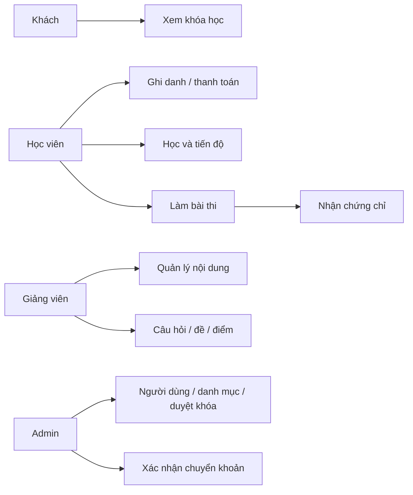

Yêu cầu phi chức năng gồm phân quyền ba lớp, validation tiếng Việt, không tin đồng hồ client, chống N+1, giao diện responsive, dữ liệu demo tái lập được và test tự động. Dữ liệu nhạy cảm không được render bằng unescaped Blade.

### 3.2 Danh sách use case đầy đủ

| Mã | Tên use case | Tác nhân | Mô tả | Tiền điều kiện | Hậu điều kiện |
|---|---|---|---|---|---|
| UC-G01 | Xem trang chủ | Khách | Xem khóa nổi bật đã xuất bản | Không | Không đổi dữ liệu |
| UC-G02 | Tìm/lọc khóa học | Khách | Lọc theo từ khóa, danh mục, cấp độ | Không | Danh sách phân trang |
| UC-G03 | Xem chi tiết khóa | Khách | Xem mô tả, chương và bài preview | Khóa published | Hiển thị thông tin |
| UC-G04 | Xem bài preview | Khách | Mở bài được đánh dấu preview | Bài thuộc khóa | Nội dung preview hiển thị |
| UC-G05 | Đăng ký tài khoản | Khách | Tạo tài khoản học viên | Email chưa tồn tại | User role student, đăng nhập |
| UC-G06 | Đăng nhập | Mọi tài khoản | Xác thực email/mật khẩu | Tài khoản tồn tại | Session xác thực |
| UC-G07 | Xác thực chứng chỉ | Khách | Tra mã chứng chỉ công khai | Có mã cần tra | Hiện hợp lệ/không tìm thấy |
| UC-S01 | Ghi danh khóa miễn phí | Học viên | Kích hoạt enrollment ngay | Đăng nhập, khóa published/free | Pivot active |
| UC-S02 | Tạo đơn khóa trả phí | Học viên | Tạo enrollment và order pending | Đăng nhập, khóa published/paid | Đơn pending |
| UC-S03 | Thanh toán thẻ giả lập | Học viên | Gửi số thẻ qua Mock gateway | Có order pending | paid+active hoặc giữ pending |
| UC-S04 | Chọn chuyển khoản | Học viên | Nhận hướng dẫn chuyển khoản | Có order pending | Chờ admin xác nhận |
| UC-S05 | Xem khóa của tôi | Học viên | Danh sách enrollment và tiến độ | Đăng nhập | Danh sách phân trang |
| UC-S06 | Học bài riêng tư | Học viên | Xem video/tài liệu | Enrollment active | Nội dung hiển thị |
| UC-S07 | Hoàn thành bài | Học viên | Gửi Fetch JSON | Enrollment active | lesson_user, phần trăm mới |
| UC-S08 | Xem đề thi | Học viên | Xem cấu hình và lịch sử lượt | Enrollment active | Không đổi dữ liệu |
| UC-S09 | Bắt đầu thi | Học viên | Tạo attempt và answer rỗng | Đề published, còn lượt, có câu | Attempt in_progress |
| UC-S10 | Lưu đáp án | Học viên | Chọn single/multiple | Attempt chưa hết hạn | JSON option IDs được lưu |
| UC-S11 | Nộp bài | Học viên | Chấm điểm tự động | Attempt in_progress | submitted, score, passed |
| UC-S12 | Xem lịch sử thi | Học viên | Danh sách attempt | Đăng nhập | Danh sách phân trang |
| UC-S13 | Xem kết quả | Học viên | Xem điểm và đáp án | Chủ attempt đã nộp | Kết quả hiển thị |
| UC-S14 | Xem chứng chỉ | Học viên | Danh sách chứng chỉ được cấp | Đăng nhập | Danh sách PDF |
| UC-S15 | Tải chứng chỉ | Học viên | Download PDF | Chủ certificate, file tồn tại | Response PDF |
| UC-I01 | Xem dashboard | Giảng viên | Thống kê khóa và học viên | Role instructor/admin | Dashboard hiển thị |
| UC-I02 | Tạo khóa học | Giảng viên | Nhập thông tin và thumbnail | Đăng nhập instructor | Course draft/published |
| UC-I03 | Sửa/xóa khóa | Giảng viên | Quản lý khóa mình sở hữu | Ownership | Dữ liệu cập nhật/xóa |
| UC-I04 | Quản lý chương | Giảng viên | CRUD section và vị trí | Sở hữu course | Section cập nhật |
| UC-I05 | Quản lý bài học | Giảng viên | CRUD video/tài liệu/URL | Sở hữu course | Lesson cập nhật |
| UC-I06 | Xem học viên khóa | Giảng viên | Xem enrollment/progress | Sở hữu course | Danh sách học viên |
| UC-I07 | Tạo câu hỏi | Giảng viên | Tạo single/multiple và options | Sở hữu course | Question/options mới |
| UC-I08 | Sửa câu hỏi | Giảng viên | Cập nhật nội dung/options | Sở hữu question | Dữ liệu thay đổi |
| UC-I09 | Xóa câu hỏi | Giảng viên | Xóa nếu chưa nằm trong đề | Không được exam sử dụng | Question xóa hoặc cảnh báo |
| UC-I10 | Tải file mẫu Excel | Giảng viên | Download `mau-cau-hoi.xlsx` | Đăng nhập instructor | Response XLSX |
| UC-I11 | Import câu hỏi | Giảng viên | Đọc XLSX/CSV và validate dòng | Sở hữu course | Câu hợp lệ được tạo |
| UC-I12 | Export câu hỏi | Giảng viên | Xuất ngân hàng câu hỏi | Sở hữu course | Response XLSX |
| UC-I13 | Tạo đề thi | Giảng viên | Chọn tay hoặc random theo độ khó | Sở hữu course | Exam và pivot questions |
| UC-I14 | Sửa/xóa đề | Giảng viên | Quản lý cấu hình đề | Sở hữu exam | Exam cập nhật/xóa |
| UC-I15 | Xem kết quả đề | Giảng viên | Thống kê avg/max/min/pass rate | Sở hữu exam | Bảng kết quả |
| UC-I16 | Export bảng điểm | Giảng viên | Tải các lượt đã nộp | Sở hữu exam | Response XLSX |
| UC-A01 | Xem dashboard admin | Admin | Thống kê hệ thống | Role admin | Dashboard hiển thị |
| UC-A02 | Quản lý người dùng | Admin | CRUD user, không tự xóa mình | Role admin | User cập nhật |
| UC-A03 | Quản lý danh mục | Admin | CRUD category | Role admin | Category cập nhật |
| UC-A04 | Duyệt/ẩn khóa học | Admin | Toggle draft/published | Role admin | Status đổi |
| UC-A05 | Xem đơn hàng | Admin | Lọc đơn theo trạng thái | Role admin | Danh sách phân trang |
| UC-A06 | Xác nhận chuyển khoản | Admin | Đổi pending thành paid và active | Order pending | Enrollment active |

### 3.3 Sơ đồ use-case kiểu flowchart

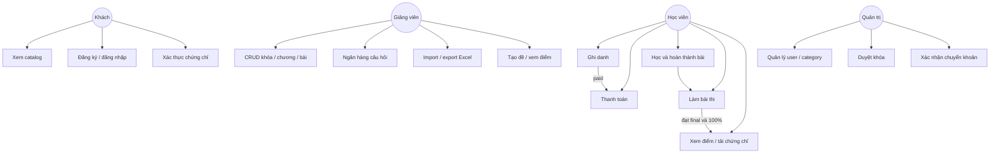

### 3.4 Đặc tả UC-S02/S03/S04 — Đăng ký khóa học trả phí

**Mục tiêu:** tạo ghi danh chờ và kích hoạt chỉ sau thanh toán hợp lệ.

**Tiền điều kiện:** người dùng đã đăng nhập với role `student`; khóa `published`; `price > 0`.

**Luồng chính:** (1) học viên POST `courses.enroll`; (2) controller kiểm tra trạng thái khóa; (3) `EnrollmentService` tạo/cập nhật pivot `course_user` thành `pending`; (4) tạo `orders` pending; (5) chuyển đến checkout; (6) học viên chọn card và nhập `4242...`; (7) gateway trả success; (8) order thành `paid`, `paid_at` được đặt; (9) service kích hoạt pivot thành `active`; (10) chuyển đến trang học.

**Luồng thay thế A:** số thẻ `4000...0002` bị từ chối; order và enrollment giữ `pending`, hiển thị flash `error`, học viên chưa mở được bài riêng tư.

**Luồng thay thế B:** chọn `bank_transfer`; order giữ `pending`; admin PATCH `admin.orders.confirm`; transaction cập nhật order `paid` và enrollment `active`.

**Hậu điều kiện:** không tồn tại đường POST trực tiếp nào kích hoạt miễn phí khóa trả phí.

### 3.5 Đặc tả UC-S09–S11 — Làm bài thi

**Tiền điều kiện:** học viên có enrollment active; exam published; exam có ít nhất một câu; số attempt đã dùng nhỏ hơn `max_attempts`.

**Luồng chính:** (1) POST start; (2) xử lý attempt cũ đang mở; (3) lấy question IDs và shuffle nếu cấu hình; (4) tạo attempt với `started_at`, `expires_at`, `question_order`; (5) tạo answer rỗng; (6) Livewire mount và authorize; (7) học viên chọn option; (8) server kiểm tra thời hạn và option; (9) nộp; (10) service khóa row, chấm từng câu, tính score phần trăm, passed và submitted_at; (11) thử cấp chứng chỉ.

**Ngoại lệ:** đề 0 câu trả flash lỗi; hết số lần thi không tạo attempt; request lưu sau hạn bị 409 và lượt được chấm; người khác truy cập attempt bị 403.

**Hậu điều kiện:** attempt không còn `in_progress`, answers có `is_correct`, kết quả có thể xem lại.

### 3.6 Đặc tả UC-I11 — Nhập câu hỏi Excel

**Tiền điều kiện:** instructor/admin đăng nhập; có quyền update course; file `xlsx`, `xls` hoặc `csv`, tối đa 5 MB.

**Luồng chính:** (1) tải template; (2) điền các cột `noi_dung`, `loai`, `do_kho`, đáp án A–F, `dap_an_dung`, `giai_thich`; (3) upload; (4) Form validation kiểm tra file; (5) `QuestionsImport` đọc heading row; (6) validation kiểm tra enum và trường bắt buộc; (7) parse chữ cái đáp án; (8) transaction tạo question/options; (9) trả success.

**Ngoại lệ:** single có nhiều đáp án đúng, multiple không có đáp án đúng hoặc chữ cái ngoài A–F được ghi vào `Failure`; giao diện nhận `import_errors` có số dòng.

**Hậu điều kiện:** chỉ câu hợp lệ được tạo cho đúng course và `created_by` là người import.

### 3.7 Đặc tả UC-S14/S15 — Cấp và tải chứng chỉ

**Tiền điều kiện:** tất cả lesson của course đã hoàn thành; nếu có final exam thì tồn tại attempt `passed=true`.

**Luồng chính:** (1) hoàn tất bài hoặc chấm thi gọi `issueIfEligible`; (2) `ProgressService` tính 100%; (3) service kiểm tra final exam; (4) `firstOrCreate` certificate theo cặp user/course; (5) tạo code duy nhất; (6) load user/course/instructor; (7) DomPDF render A4 landscape; (8) lưu disk public; (9) trả certificate; (10) owner tải qua controller có policy; khách tra code ở route verify.

**Ngoại lệ:** chưa đủ tiến độ hoặc chưa đạt final thì trả `null`; file bị thiếu được tạo lại; user khác download bị 403; code không tồn tại vẫn trả trang tra cứu với thông báo.

**Hậu điều kiện:** tối đa một certificate cho một user/course do unique constraint.

### 3.8 Yêu cầu phi chức năng chi tiết

| Mã | Yêu cầu | Cách đáp ứng |
|---|---|---|
| NFR-01 | Bảo mật xác thực | Breeze, Hash, session, CSRF |
| NFR-02 | Phân quyền | auth → role/enrolled → Gate/Policy → Blade `@can` |
| NFR-03 | Toàn vẹn dữ liệu | FK, unique, transaction, route binding |
| NFR-04 | Hiệu năng danh sách | eager loading, count subquery, pagination |
| NFR-05 | Khả dụng | tiếng Việt, flash success/error, responsive UI |
| NFR-06 | Tin cậy thời gian thi | `expires_at` kiểm tra server, auto grade |
| NFR-07 | Khả năng kiểm thử | SQLite memory, factory, Storage fake, E2E |
| NFR-08 | Khả năng bảo trì | route module, Form Request, Policy, Service |
| NFR-09 | Tương thích dữ liệu | import/export XLSX/CSV, PDF chuẩn tải xuống |
| NFR-10 | Tái lập demo | `migrate:fresh --seed`, tài khoản cố định |

## 4. Thiết kế

### 4.1 Kiến trúc

Trình duyệt gửi yêu cầu đến nhóm route `student`, `instructor`, `admin`, `exam`; middleware xác thực/phân quyền; controller hoặc Livewire gọi service; Eloquent truy cập MySQL; kết quả trả Blade, JSON, PDF hoặc XLSX.

### 4.2 ERD sinh theo migration

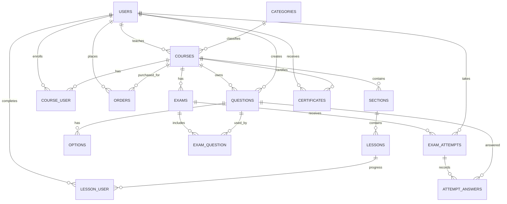

### 4.3 Mô tả bảng

| Bảng | Mục đích |
|---|---|
| `users` | tài khoản, vai trò, hồ sơ |
| `categories`, `courses` | phân loại và thông tin khóa học |
| `sections`, `lessons` | cấu trúc nội dung, video/tài liệu, preview |
| `course_user`, `lesson_user` | ghi danh và tiến độ N-N |
| `orders` | số tiền, phương thức, trạng thái thanh toán |
| `questions`, `options` | ngân hàng câu hỏi và phương án đúng/sai |
| `exams`, `exam_question` | cấu hình đề và câu hỏi/điểm/thứ tự |
| `exam_attempts`, `attempt_answers` | thời gian, điểm, trạng thái và đáp án từng lượt |
| `certificates` | mã duy nhất, ngày cấp và đường dẫn PDF |

### 4.3.1 Từ điển dữ liệu theo migration

#### Bảng `users`

| Cột | Kiểu/thuộc tính | Ràng buộc và ý nghĩa |
|---|---|---|
| `id` | bigint unsigned | khóa chính |
| `name` | varchar | họ tên hiển thị |
| `email` | varchar | unique, tài khoản đăng nhập |
| `email_verified_at` | timestamp nullable | thời điểm xác thực email |
| `password` | varchar | mật khẩu đã hash |
| `role` | enum | `admin`, `instructor`, `student`; mặc định student |
| `avatar` | varchar nullable | đường dẫn ảnh đại diện |
| `bio` | text nullable | giới thiệu |
| `remember_token` | varchar nullable | Breeze remember login |
| `created_at`, `updated_at` | timestamp | dấu vết thời gian |

#### Bảng `categories`

| Cột | Kiểu/thuộc tính | Ràng buộc và ý nghĩa |
|---|---|---|
| `id` | bigint unsigned | khóa chính |
| `name` | varchar | tên danh mục |
| `slug` | varchar | unique, dùng trong URL/dữ liệu |
| `description` | text nullable | mô tả danh mục |
| timestamps | timestamp | ngày tạo/cập nhật |

#### Bảng `courses`

| Cột | Kiểu/thuộc tính | Ràng buộc và ý nghĩa |
|---|---|---|
| `id` | bigint unsigned | khóa chính |
| `instructor_id` | FK users | cascade delete, chủ khóa |
| `category_id` | FK categories | cascade delete |
| `title` | varchar | tên khóa |
| `slug` | varchar | unique, route key |
| `short_description` | text nullable | mô tả ngắn |
| `description` | longtext nullable | nội dung giới thiệu |
| `thumbnail` | varchar nullable | file disk public |
| `price` | decimal(12,0) | 0 là miễn phí |
| `level` | enum | beginner/intermediate/advanced |
| `status` | enum,index | draft/published |
| timestamps | timestamp | ngày tạo/cập nhật |

#### Bảng `sections` và `lessons`

| Bảng.cột | Kiểu/thuộc tính | Ràng buộc và ý nghĩa |
|---|---|---|
| `sections.course_id` | FK courses | cascade delete |
| `sections.title` | varchar | tên chương |
| `sections.position` | unsigned int | thứ tự |
| `lessons.section_id` | FK sections | cascade delete |
| `lessons.title` | varchar | tên bài |
| `lessons.type` | enum | video/document |
| `video_path`, `video_url` | varchar nullable | file hoặc URL video |
| `document_path` | varchar nullable | file tài liệu |
| `content` | longtext nullable | nội dung bài |
| `duration_minutes` | unsigned int | thời lượng |
| `position` | unsigned int | thứ tự trong chương |
| `is_preview` | boolean | khách được phép xem |

#### Bảng `course_user`, `lesson_user`, `orders`

| Bảng.cột | Kiểu/thuộc tính | Ràng buộc và ý nghĩa |
|---|---|---|
| `course_user.user_id` | FK users | cascade delete |
| `course_user.course_id` | FK courses | unique cùng user_id |
| `course_user.status` | enum | pending/active |
| `price_paid` | decimal(12,0) | số tiền ghi nhận |
| `enrolled_at` | timestamp nullable | lúc kích hoạt |
| `completed_at` | timestamp nullable | lúc đạt 100% bài |
| `lesson_user.user_id` | FK users | unique với lesson_id |
| `lesson_user.lesson_id` | FK lessons | bài hoàn thành |
| `lesson_user.completed_at` | timestamp nullable | thời điểm hoàn thành |
| `orders.user_id` | FK users | người đặt |
| `orders.course_id` | FK courses | khóa mua |
| `orders.code` | varchar unique | mã đơn |
| `orders.amount` | decimal(12,0) | số tiền |
| `orders.method` | varchar | card/bank_transfer |
| `orders.status` | enum | pending/paid/failed |
| `orders.paid_at` | timestamp nullable | lúc xác nhận |

#### Bảng câu hỏi và đề thi

| Bảng.cột | Kiểu/thuộc tính | Ràng buộc và ý nghĩa |
|---|---|---|
| `questions.course_id` | FK courses | cascade delete |
| `questions.created_by` | FK users | người tạo |
| `questions.content` | text | nội dung câu |
| `questions.type` | enum | single/multiple |
| `questions.difficulty` | enum | easy/medium/hard |
| `questions.explanation` | text nullable | giải thích |
| `options.question_id` | FK questions | cascade delete |
| `options.content` | text | phương án |
| `options.is_correct` | boolean | đáp án đúng |
| `exams.course_id` | FK courses | cascade delete |
| `exams.title` | varchar | tên đề |
| `duration_minutes` | unsigned int | thời gian thi |
| `pass_score` | decimal(5,2) | ngưỡng phần trăm |
| `max_attempts` | unsigned int | số lượt tối đa |
| `shuffle_questions` | boolean | trộn thứ tự |
| `is_final` | boolean | đề cuối khóa |
| `status` | enum | draft/published |
| `exam_question.exam_id` | FK exams | unique với question_id |
| `exam_question.question_id` | FK questions | câu thuộc đề |
| `exam_question.points` | decimal(5,2) | trọng số |
| `exam_question.position` | unsigned int | thứ tự |

#### Bảng lượt thi và chứng chỉ

| Bảng.cột | Kiểu/thuộc tính | Ràng buộc và ý nghĩa |
|---|---|---|
| `exam_attempts.exam_id` | FK exams | đề được làm |
| `exam_attempts.user_id` | FK users | học viên |
| `started_at`, `expires_at` | timestamp | cửa sổ thời gian server |
| `submitted_at` | timestamp nullable | lúc chấm/nộp |
| `score` | decimal(6,2) nullable | điểm phần trăm |
| `correct_count`, `total` | unsigned int | thống kê số câu |
| `passed` | boolean | đạt ngưỡng |
| `status` | enum | in_progress/submitted/expired |
| `question_order` | JSON nullable | migration bổ sung, thứ tự ổn định |
| `attempt_answers.exam_attempt_id` | FK attempts | unique với question_id |
| `attempt_answers.question_id` | FK questions | câu được trả lời |
| `selected_option_ids` | JSON nullable | mảng ID lựa chọn |
| `is_correct` | boolean | kết quả chấm |
| `certificates.user_id` | FK users | unique cùng course_id |
| `certificates.course_id` | FK courses | khóa được chứng nhận |
| `certificates.code` | varchar unique | mã tra cứu công khai |
| `certificates.issued_at` | timestamp | ngày cấp |
| `certificates.file_path` | varchar nullable | PDF trên disk public |

### 4.4 Sơ đồ tuần tự

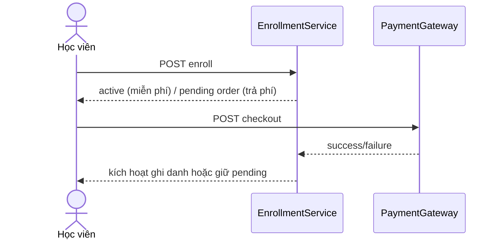

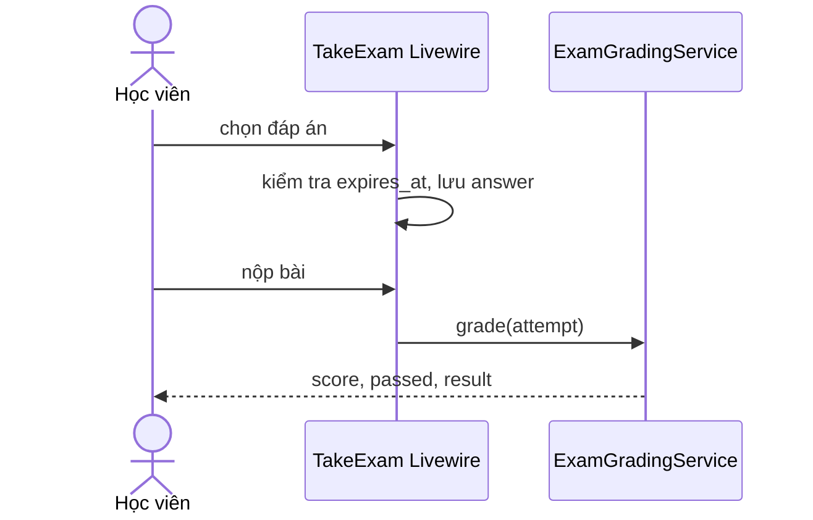

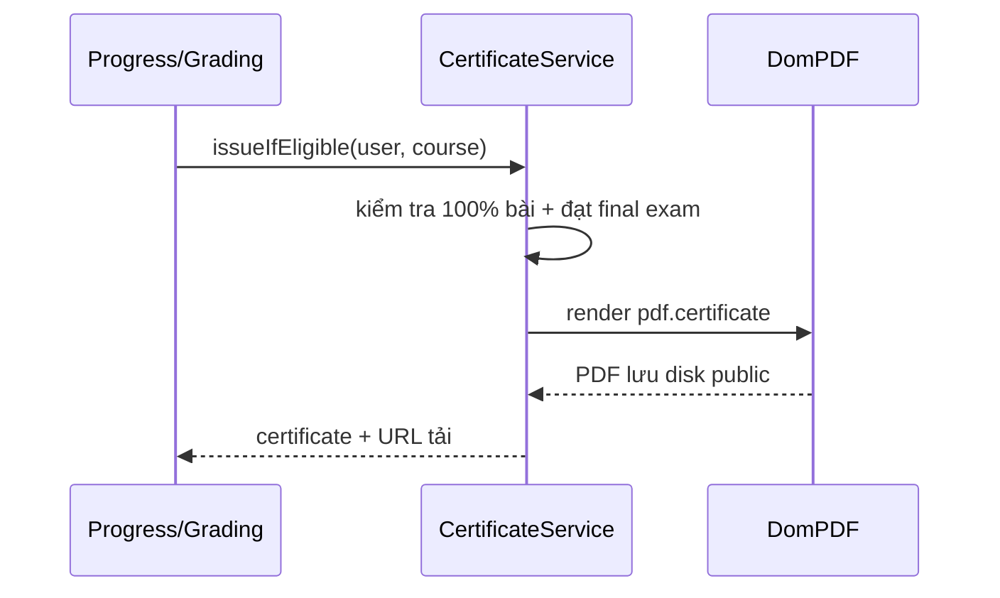

### 4.5 Ma trận phân quyền

| Chức năng | Khách | Học viên | Giảng viên sở hữu | Admin |
|---|:---:|:---:|:---:|:---:|
| Catalog/verify | ✓ | ✓ | ✓ | ✓ |
| Bài private | đăng nhập | khi active | preview nội dung sở hữu | ✓ |
| Ghi danh/thi/tải chứng chỉ | – | tài nguyên của mình | – | theo policy |
| CRUD nội dung/đề/câu hỏi | – | – | ✓ | ✓ |
| Quản trị/xác nhận đơn | – | – | – | ✓ |

Route chính: `/`, `/courses/{course}`, `/learn/{course}/{lesson?}`, `/checkout/{course}`, `/exams/{exam}`, `/attempts/{attempt}/take`, `/certificates/verify/{code}`, nhóm `/student/*`, `/instructor/*`, `/admin/*`. Danh sách chính xác lấy bằng `php artisan route:list --except-vendor`.

### 4.6 Bảng route nghiệp vụ chính

| Method | URI | Tên route | Bảo vệ |
|---|---|---|---|
| GET | `/` | `home` | public |
| GET | `/courses` | `courses.index` | public |
| GET | `/courses/{course:slug}` | `courses.show` | public |
| POST | `/courses/{course:slug}/enroll` | `courses.enroll` | auth, student |
| GET/POST | `/checkout/{course:slug}` | `checkout.show/pay` | auth, student |
| GET | `/learn/{course}/{lesson?}` | `learn.show` | auth, enrolled |
| POST | `/lessons/{lesson}/complete` | `lessons.complete` | auth, student, JSON |
| GET | `/exams/{exam}` | `exams.show` | auth, nghiệp vụ enrollment |
| POST | `/exams/{exam}/start` | `exams.start` | auth, throttle |
| GET | `/attempts/{attempt}/take` | `attempts.take` | auth, can:update |
| GET | `/attempts/{attempt}/result` | `attempts.result` | auth, can:view |
| GET | `/student/attempts` | `student.attempts` | auth |
| GET | `/student/certificates` | `certificates.index` | auth |
| GET | `/certificates/{certificate}/download` | `certificates.download` | auth, can:view |
| GET | `/certificates/verify/{code}` | `certificates.verify` | public |
| GET | `/admin/dashboard` | `admin.dashboard` | auth, admin |
| PATCH | `/admin/orders/{order}/confirm` | `admin.orders.confirm` | auth, admin |
| resource | `/admin/users` | `admin.users.*` | auth, admin |
| resource | `/admin/categories` | `admin.categories.*` | auth, admin |
| resource | `/instructor/courses` | `instructor.courses.*` | instructor/admin, policy |
| resource | `/instructor/courses/{course}/questions` | `instructor.courses.questions.*` | role, can:update/view |
| POST | `/instructor/courses/{course}/questions/import` | `instructor.courses.questions.import` | can:update |
| GET | `/instructor/courses/{course}/questions/export` | `instructor.courses.questions.export` | can:update |
| resource | `/instructor/courses/{course}/exams` | `instructor.courses.exams.*` | role, policy |
| GET | `/instructor/exams/{exam}/results` | `instructor.exams.results` | can:view |
| GET | `/instructor/exams/{exam}/scores/export` | `instructor.exams.scores.export` | can:view |

## 5. Cài đặt

Cấu trúc thực tế được trình bày trong `README.md`. Các điểm cài đặt tiêu biểu:

- `CheckRole::handle()` tách danh sách vai trò và từ chối 403; alias `role` được đăng ký trong `bootstrap/app.php`, sau `auth` trên route.
- Policy như `CoursePolicy`, `QuestionPolicy`, `ExamAttemptPolicy` kiểm tra admin, ownership và chủ lượt thi; controller tiếp tục gọi `Gate::authorize`/`authorize`.
- `LessonRequest` kiểm tra file và dùng custom `YoutubeUrl`; `QuestionRequest` dùng `AtLeastOneCorrectOption`; thông báo/thuộc tính bằng tiếng Việt.
- `PaymentGatewayInterface::charge(Order $order, array $data): PaymentResult` cho phép thay gateway mà không đổi checkout controller.
- `TakeExam::selectOption()` xác nhận option thuộc câu hiện tại, kiểm tra quyền/thời hạn rồi lưu JSON `selected_option_ids`.
- `ExamGradingService` khóa lượt thi trong transaction, so sánh tập option đúng, tính phần trăm an toàn khi tổng điểm bằng 0 và gọi cấp chứng chỉ.
- `CertificateService` kiểm tra tiến độ/final exam, tạo mã duy nhất, render PDF và tránh cấp trùng bằng unique `(user_id, course_id)`.
- `QuestionsImport` validate từng dòng; `ExamScoresExport` eager-load lượt thi/người dùng để xuất bảng điểm.
- `LearnController::complete()` dùng `ProgressService`, trả JSON gồm `progress`, `course_completed`, `certificate_url`; `learn.js` cập nhật giao diện.

## 6. Kiểm thử

| Nhóm | Ca kiểm thử tiêu biểu | Kỳ vọng |
|---|---|---|
| Auth/role | đăng ký, đăng nhập, redirect dashboard | đúng vai trò |
| Learning | draft không xuất hiện; free active; private bị chặn | đúng HTTP/trạng thái DB |
| Payment | thẻ 4242 thành công; 4000…0002 giữ pending; admin xác nhận | enrollment đúng |
| Exam | max attempts, đề rỗng, hết giờ, đáp án đúng | server cưỡng chế và chấm đúng |
| Certificate | đủ tiến độ + đạt final; verify công khai | PDF tồn tại, mã hợp lệ |
| Excel | template/import/export | XLSX hợp lệ, dữ liệu khứ hồi |
| Authorization | guest/student/giảng viên khác/admin | redirect/403 đúng |

Kết quả chạy thật được cập nhật ở lần nghiệm thu cuối bằng `php artisan test`; test đặt trong `tests/Feature`, gồm nhóm tích hợp `tests/Feature/E2E`.

### 6.1 Danh sách test case thực tế

| ID | Tên test trong mã nguồn | Mô tả | Kết quả |
|---|---|---|---|
| TC-01 | `registration_screen_can_be_rendered` | mở trang đăng ký | Pass |
| TC-02 | `new_users_can_register` | tạo tài khoản học viên | Pass |
| TC-03 | `users_can_authenticate_using_the_login_screen` | đăng nhập đúng | Pass |
| TC-04 | `users_can_not_authenticate_with_invalid_password` | từ chối mật khẩu sai | Pass |
| TC-05 | `each_role_lands_on_its_dashboard_after_login` | redirect theo role | Pass |
| TC-06 | `public_catalog_only_shows_published_courses` | ẩn draft khỏi public | Pass |
| TC-07 | `free_course_is_activated_immediately` | khóa free active ngay | Pass |
| TC-08 | `paid_course_card_payment_activates_enrollment` | thẻ thành công | Pass |
| TC-09 | `unenrolled_student_cannot_open_private_lesson` | private trả 403 | Pass |
| TC-10 | `completed_lesson_returns_json_and_updates_progress` | JSON tiến độ và pivot | Pass |
| TC-11 | `registered_student_completes_free_course_passes_final_exam_and_receives_certificate` | E2E toàn luồng | Pass |
| TC-12 | `card_success_activates_enrollment_and_decline_keeps_it_pending` | cả thẻ success/decline | Pass |
| TC-13 | `bank_transfer_stays_pending_until_admin_confirms` | admin kích hoạt chuyển khoản | Pass |
| TC-14 | `guest_is_redirected_from_every_protected_module` | matrix guest | Pass |
| TC-15 | `student_other_instructor_owner_instructor_and_admin_matrix` | matrix năm vai trò | Pass |
| TC-16 | `exam_without_questions_cannot_start_and_used_question_cannot_be_deleted` | guard tích hợp | Pass |
| TC-17 | `student_can_start_answer_and_submit_single_and_multiple_questions` | chấm single/multiple | Pass |
| TC-18 | `saving_after_expiry_is_rejected_and_attempt_is_finalized` | từ chối sau hạn | Pass |
| TC-19 | `max_attempts_is_enforced` | cưỡng chế số lượt | Pass |
| TC-20 | `another_student_cannot_access_attempt` | policy attempt | Pass |
| TC-21 | `certificate_is_issued_only_when_eligible_and_pdf_exists` | điều kiện và file PDF | Pass |
| TC-22 | `verify_page_handles_valid_and_invalid_codes` | verify public | Pass |
| TC-23 | `template_is_xlsx_and_question_export_can_be_imported_without_losing_correct_options` | round trip Excel | Pass |
| TC-24 | `generated_xlsx_import_creates_questions_and_options` | import XLSX | Pass |
| TC-25 | `invalid_row_is_reported_in_vietnamese` | lỗi import có số dòng | Pass |
| TC-26 | `owner_can_export_exam_scores` | export bảng điểm | Pass |
| TC-27 | `random_builder_selects_requested_difficulty_counts` | tạo đề random | Pass |
| TC-28 | `manual_builder_keeps_order_and_points` | giữ thứ tự/trọng số | Pass |
| TC-29 | `admin_can_toggle_course_and_confirm_order` | duyệt khóa/xác nhận đơn | Pass |
| TC-30 | `instructor_cannot_edit_another_instructors_course` | ownership course | Pass |
| TC-31 | `admin_can_manage_categories_and_users` | admin quản lý danh mục và người dùng | Pass |
| TC-32 | `non_admin_is_forbidden_and_admin_cannot_delete_self` | chặn non-admin, admin không tự xóa mình | Pass |
| TC-33 | `instructor_can_build_course_sections_and_lessons` | giảng viên dựng khóa/chương/bài | Pass |
| TC-34 | `lesson_upload_is_deleted_with_lesson` | xóa file upload khi xóa bài học | Pass |
| TC-35 | `another_instructor_cannot_access_question_bank` | ownership ngân hàng câu hỏi | Pass |
| TC-36 | `owner_can_render_question_and_exam_pages` | chủ khóa mở trang câu hỏi/đề thi | Pass |
| TC-37 | `draft_course_cannot_be_enrolled_and_paid_course_is_never_activated_for_free` | không ghi danh khóa nháp, không kích hoạt khóa trả phí miễn phí | Pass |
| TC-38 | `guest_private_lesson_redirects_to_login_and_unenrolled_student_is_forbidden` | khách về login, học viên chưa ghi danh bị 403 | Pass |
| TC-39 | `completed_course_with_certificate_shows_view_certificate_button_opening_pdf_inline` | nút "Xem chứng chỉ" mở PDF inline | Pass |
| TC-40 | `finished_lessons_without_passed_final_exam_prompts_final_exam` | học xong nhưng chưa đạt thi cuối thì gợi ý thi | Pass |
| TC-41 | `progress_service_returns_first_uncompleted_lesson` | xác định bài học tiếp theo | Pass |
| TC-42 | `it_builds_84_days_and_combines_activity_sources` | heatmap 12 tuần gộp bài học và lượt thi | Pass |

Ngoài 42 ca trên, 21 test còn lại là bộ test mặc định của Laravel Breeze (đăng ký, đăng nhập, quên/đặt lại mật khẩu, xác minh email, hồ sơ cá nhân) và 2 test mẫu của Laravel; tất cả đều pass.

### 6.2 Kết quả chạy nghiệm thu

Lệnh thực hiện:

```bash
php artisan test
```

Kết quả thực tế ở lần nghiệm thu cuối (17/11/2026):

```text
Tests: 63 passed (276 assertions)
Duration: 2.14s
```

Các ca timing được kiểm chứng chính xác bởi `OnlineExamTest::test_saving_after_expiry_is_rejected_and_attempt_is_finalized` và `OnlineExamTest::test_max_attempts_is_enforced`; vì vậy không tạo bản sao `ExamTimingTest` chỉ đổi tên. Việc mở attempt hết hạn cũng nằm trong ca đầu: Livewire mount gọi finalize và redirect đến result.

## 7. Kết quả giao diện

Ảnh dưới đây được chụp tự động bằng Chrome headless từ ứng dụng chạy thật với dữ liệu seed (đăng nhập bằng các tài khoản demo); ảnh bổ sung nằm trong `docs/images/extra/`.

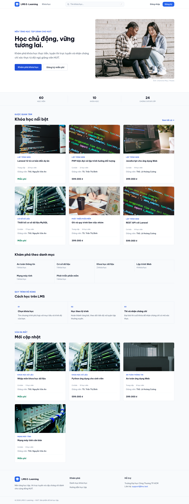

*Trang công khai: khóa nổi bật, tìm kiếm/lọc và trạng thái miễn phí/trả phí.*

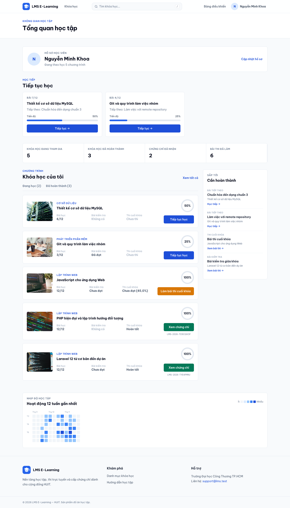

*Hồ sơ học viên, dải "Tiếp tục học" với bài kế tiếp, tab Đang học/Đã hoàn thành, trạng thái bài học/bài kiểm tra/thi cuối khóa, nút "Xem chứng chỉ" và heatmap hoạt động 12 tuần.*

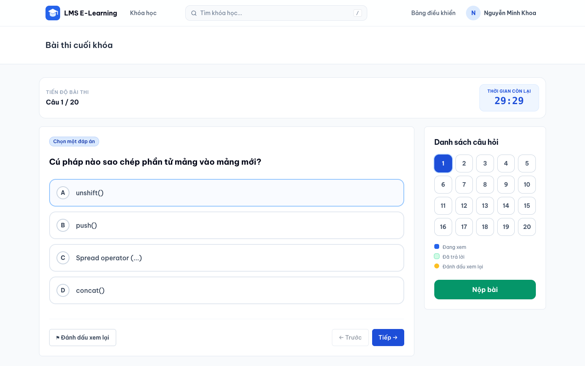

*Đồng hồ, điều hướng câu, trạng thái đã trả lời và nút nộp.*

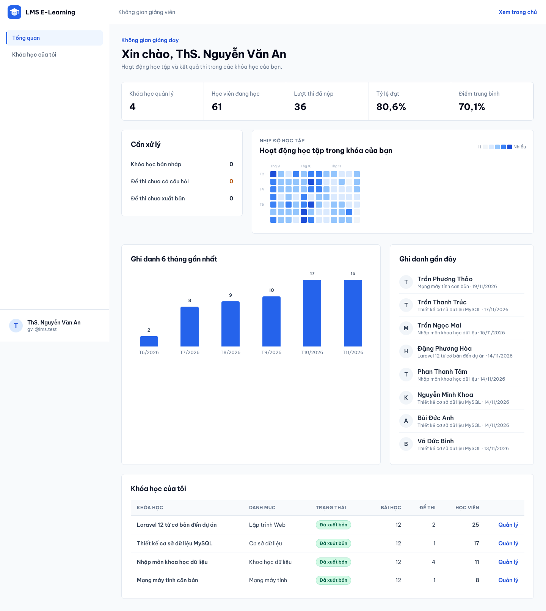

*Chỉ số lượt thi, tỷ lệ đạt, điểm trung bình, biểu đồ ghi danh 6 tháng, ghi danh gần đây và bảng khóa học.*

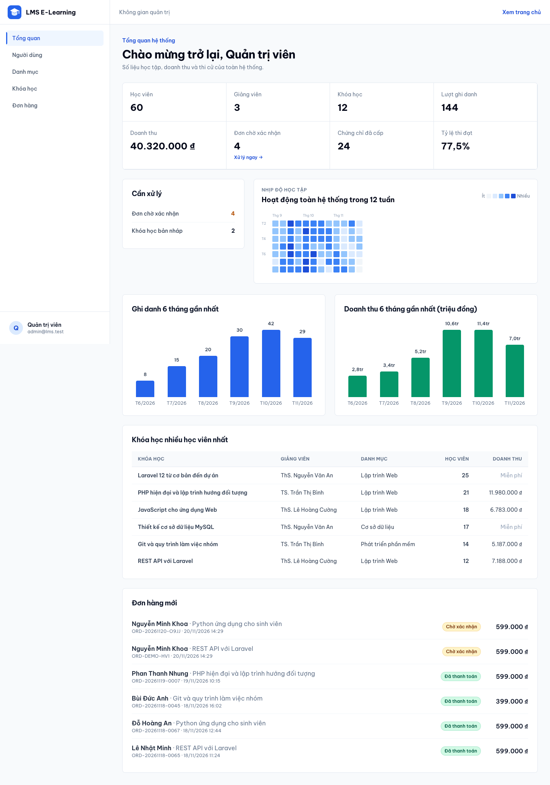

*8 chỉ số tổng quan, khung "Cần xử lý", heatmap hoạt động, biểu đồ ghi danh và doanh thu 6 tháng, khóa học nhiều học viên nhất và đơn hàng mới.*

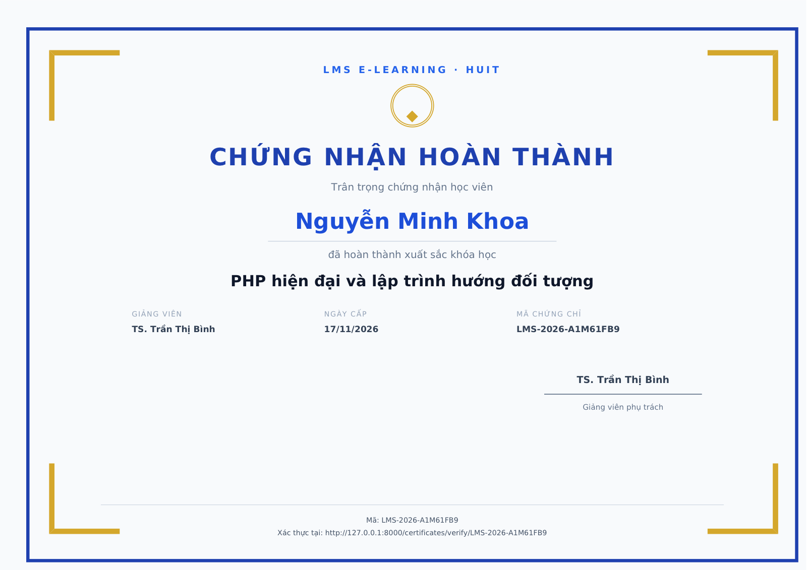

*Tên học viên, khóa học, giảng viên, mã chứng chỉ và ngày cấp.*

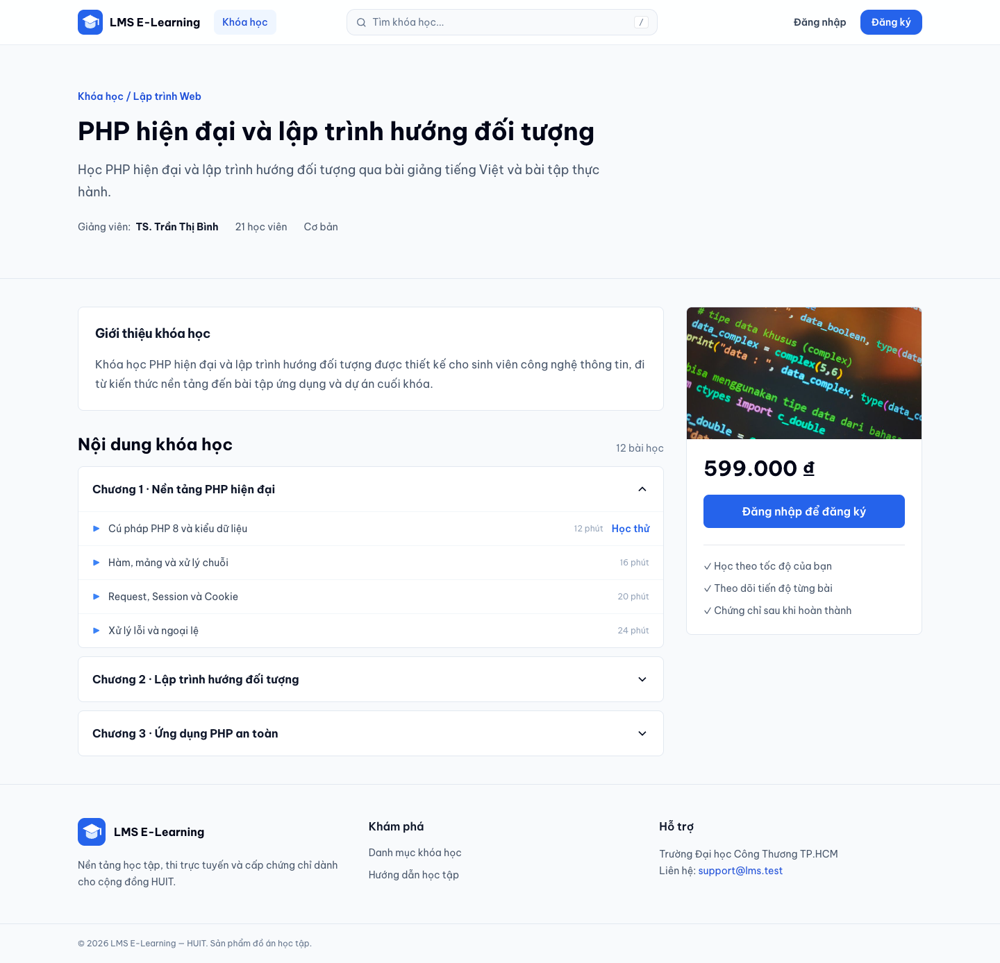

*Thông tin giảng viên, chương/bài, giá và CTA ghi danh.*

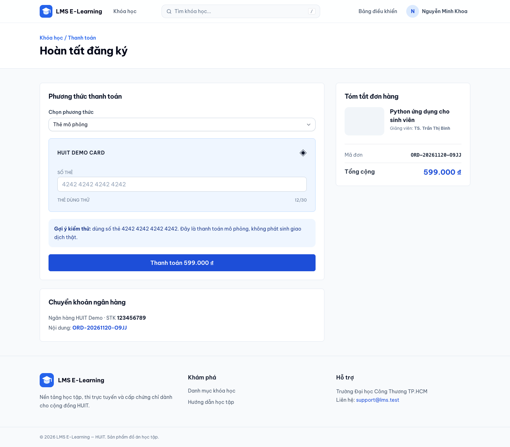

*Chọn thẻ mô phỏng hoặc chuyển khoản và hiển thị trạng thái đơn.*

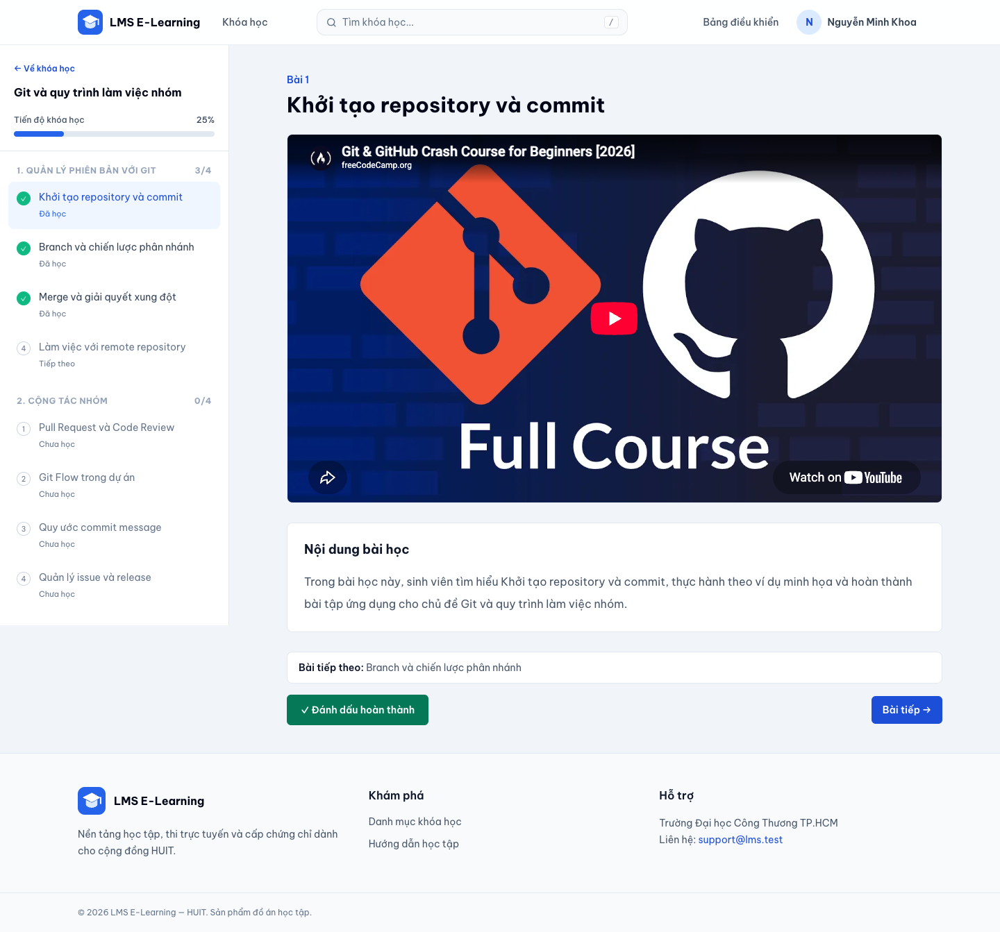

*Sidebar chương/bài, nội dung video/tài liệu và thanh tiến độ.*

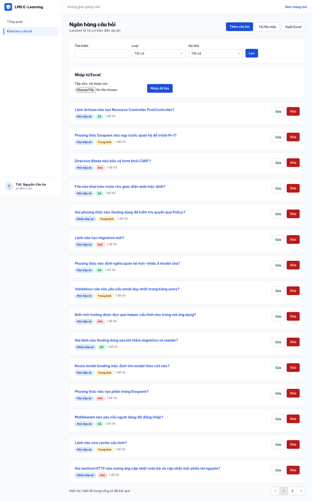

*Bộ lọc, số đề đang sử dụng câu hỏi và thao tác Excel.*

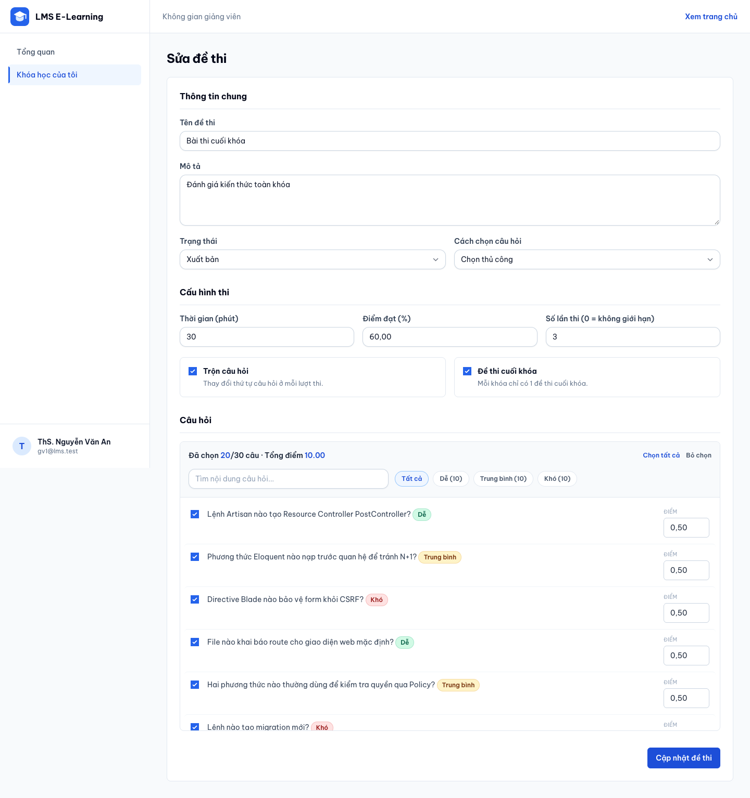

*Thiết lập thời lượng, điểm đạt, số lượt và chọn câu hỏi.*

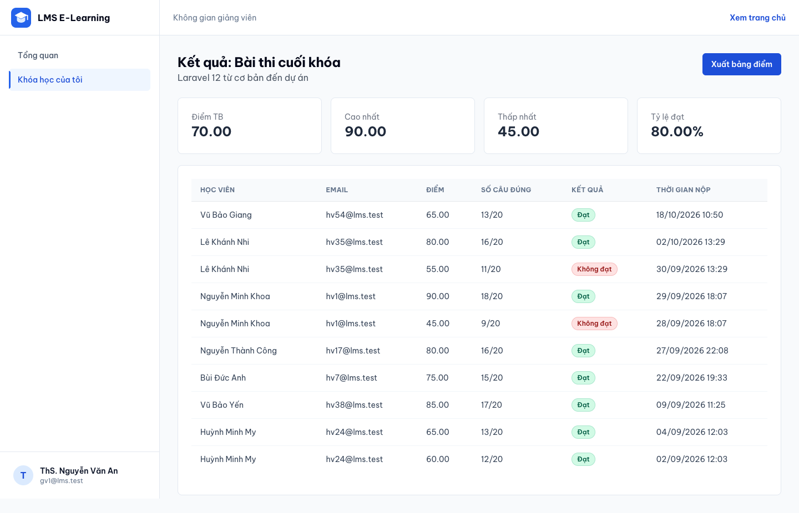

*Điểm trung bình/cao nhất/thấp nhất, tỷ lệ đạt và nút export.*

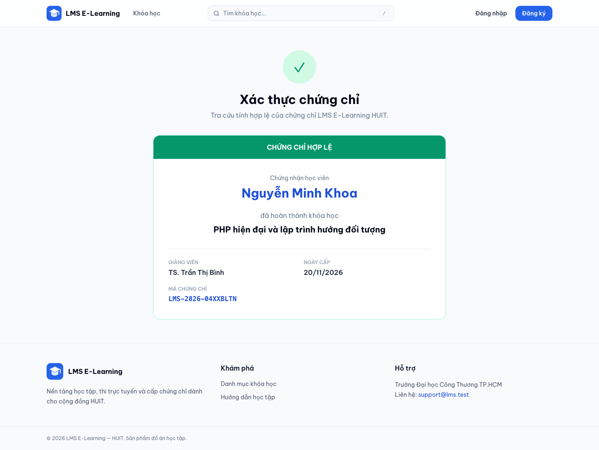

*Kết quả mã hợp lệ hoặc thông báo không tìm thấy.*

## 8. Kết luận và hướng phát triển

### 8.1 Kết quả đạt được

Đồ án hoàn thiện một LMS đa vai trò với 99 route ứng dụng. Luồng học viên đi từ đăng ký, ghi danh, thanh toán, học, thi đến chứng chỉ; giảng viên quản lý nội dung/câu hỏi/đề/điểm; admin quản lý dữ liệu và xác nhận chuyển khoản. Kiến trúc tuân theo MVC, Eloquent, migration, Form Request, middleware, policy và service. Bộ test gồm 63 test/276 assertion đều pass.

### 8.2 Hạn chế

- Thanh toán chỉ là mô phỏng, chưa xác thực webhook từ ngân hàng.
- Video dùng file/URL, chưa có transcoding adaptive streaming.
- Thi trực tuyến chưa có proctoring, phát hiện đổi tab hay nhận diện khuôn mặt.
- Chưa có email/notification queue cho xác nhận đơn và cấp chứng chỉ.
- Dashboard mới tập trung thống kê nghiệp vụ cơ bản, chưa có learning analytics sâu.

### 8.3 Hướng phát triển

- Tích hợp VNPay/MoMo với chữ ký và webhook idempotent.
- Lưu video/object trên S3-compatible storage và phát HLS.
- Thêm queue, email, notification trong ứng dụng.
- Thêm rubric, bài tập tự luận và chấm thủ công.
- Thêm ngân hàng đề theo blueprint và random có seed kiểm toán.
- Thêm giới hạn thiết bị, nhật ký sự kiện thi và cảnh báo gian lận.
- Xây API token cho ứng dụng mobile.
- Bổ sung báo cáo cohort, thời gian học và phân tích câu hỏi.

## 9. Tài liệu tham khảo

1. Laravel, *Laravel 12.x Documentation*, https://laravel.com/docs/12.x (truy cập tháng 11/2026).
2. Livewire, *Livewire 3 Documentation*, https://livewire.laravel.com/docs/3.x (truy cập tháng 11/2026).
3. barryvdh, *Laravel DomPDF*, https://github.com/barryvdh/laravel-dompdf (truy cập tháng 11/2026).
4. SpartnerNL, *Laravel Excel Documentation*, https://docs.laravel-excel.com (truy cập tháng 11/2026).
5. Laravel, *Laravel Breeze*, https://laravel.com/docs/12.x/starter-kits (truy cập tháng 11/2026).
6. PHP Group, *PHP Manual — Classes and Objects*, https://www.php.net/manual/en/language.oop5.php.
7. Tài liệu slide học phần Lập trình mã nguồn mở HUIT: Chương 2 PHP OOP; Bài 6 Laravel/MVC; Bài 7 Routing/Blade; Bài 8 Eloquent/Migration/Seeder; Bài 9 Validation/Middleware/Auth/Policy; phần JavaScript và tương tác PHP.
