# PROJECT REPORT: E-LEARNING LMS SYSTEM

## Table of Contents

1. [Introduction](#1-introduction)
2. [Theoretical Background](#2-theoretical-background)
3. [Requirements Analysis](#3-requirements-analysis)
4. [Design](#4-design)
5. [Implementation](#5-implementation)
6. [Testing](#6-testing)
7. [User Interface Results](#7-user-interface-results)
8. [Conclusion and Future Work](#8-conclusion-and-future-work)
9. [References](#9-references)

## 1. Introduction

### 1.1 Rationale

Online learning requires a unified flow between content management, knowledge assessment, and the confirmation of results. An LMS project is well suited to applying the full range of knowledge from the Open Source Programming course (Lập trình mã nguồn mở): object-oriented PHP, MVC, relational databases, authentication, authorization, testing, and JSON communication.

### 1.2 Objectives, Scope, and Target Users

The objective is to build a Laravel 12 application that runs in practice with four actors: guest, student, instructor, and administrator. The scope covers courses/sections/lessons, enrollment and simulated payment, progress tracking, a question bank, multiple-choice exams, a gradebook, and PDF certificates. Exams have an opening/closing time window and browser-level anti-cheat monitoring (detecting when the user leaves the tab/window, and blocking copy and paste). The system does not implement video streaming, a real payment gateway, or face/webcam recognition.

## 2. Theoretical Background

- **PHP OOP:** PSR-4 namespaces, encapsulation, and polymorphism are applied in `app/Services`, most clearly through `PaymentGatewayInterface` together with `MockPaymentGateway`/`BankTransferGateway` (Chapter 2 content).
- **MVC and Routing:** named routes dispatch requests to controllers, which use Eloquent and then return Blade views (Lessons 6–8).
- **Eloquent/Migration/Seeder:** migrations create the entire schema; models declare `$fillable`, casts, and 1-1, 1-N, and N-N relationships; factories/seeders create demo data (Lesson 8).
- **Blade:** layouts, partials, and components make the interface reusable; output is escaped with `{{ }}` (Lesson 7).
- **Middleware/Auth:** Breeze handles registration/login; `CheckRole` and `EnsureEnrolled` protect routes (Lesson 9).
- **Gate/Policy/Validation:** the `admin` Gate, resource-ownership policies, Form Requests, and custom rules protect input on the server (Lesson 9).
- **Livewire 3:** `TakeExam` saves answers and navigates between questions without reloading the page; the deadline is still verified on the server.
- **DomPDF:** `CertificateService` renders a Blade view to PDF and stores it on the `public` disk.
- **Laravel Excel:** `QuestionsImport`, `QuestionsExport`, `QuestionTemplateExport`, and `ExamScoresExport` are used for XLSX exchange.
- **Fetch API/JSON:** `resources/js/learn.js` calls `lessons.complete`; the controller returns the progress and the certificate URL.

### 2.1 Object-Oriented PHP and PSR-4 — Chapter 2

Composer maps the `App\\` namespace to the `app/` directory. Business classes each have their own responsibility, and dependencies are injected through the constructor or action parameters. An example of payment polymorphism in `PaymentGatewayInterface.php`:

```php
interface PaymentGatewayInterface
{
    public function charge(Order $order, array $data): PaymentResult;
}
```

`MockPaymentGateway` and `BankTransferGateway` both comply with this contract. `CheckoutController` does not need to know the processing details of each gateway; instead it asks `PaymentGatewayFactory` to return the implementation for the chosen method. This illustrates interfaces, encapsulation, and polymorphism in the OOP part of Chapter 2.

### 2.2 MVC Architecture — Lesson 6

A route receives the HTTP request, the controller coordinates, Eloquent models represent the data, and Blade renders the output. An example of the lesson completion flow:

```php
Route::post('/lessons/{lesson}/complete', [LearnController::class, 'complete'])
    ->name('lessons.complete');
```

The controller receives the `Lesson` through route model binding, calls `ProgressService`, and then returns JSON. There is no raw SQL or PDO in controllers. This rule corresponds to R1 of the plan.

### 2.3 Routing and RESTful Resources — Lesson 7

The instructor route group uses a shared prefix, name, and middleware:

```php
Route::prefix('instructor')->name('instructor.')
    ->middleware(['auth', 'role:instructor,admin'])
    ->group(function () {
        Route::resource('courses', CourseController::class);
    });
```

`Route::resource` creates the seven standard actions `index`, `create`, `store`, `show`, `edit`, `update`, and `destroy`. URLs in the application are generated with `route()` rather than hard-coded.

### 2.4 Blade, Layouts, and Components — Lesson 7

The interface lives in `resources/views`. Layouts use `<x-app-layout>`, and content areas use components such as `<x-card>`, `<x-alert>`, `<x-button>`, and `<x-progress-bar>`. User data uses the escaping syntax `{{ $value }}`; a check with `rg '\{!!' resources/views` finds no raw echo.

### 2.5 Migration and Eloquent — Lesson 8

The migration `2026_01_01_000100_create_lms_tables.php` creates the business tables and foreign keys. Models declare `$fillable`, casts, and relationships. For example, `Course`:

```php
public function lessons(): HasManyThrough
{
    return $this->hasManyThrough(Lesson::class, Section::class);
}

public function students(): BelongsToMany
{
    return $this->belongsToMany(User::class)
        ->withPivot('status', 'price_paid', 'enrolled_at', 'completed_at')
        ->withTimestamps();
}
```

The 1-1 relationship is represented by `Course::finalExam()`, 1-N by `Course::sections()`, and N-N by `Course::students()`/`Exam::questions()`.

### 2.6 Factory, Seeder, and Faker — Lesson 8

`DatabaseSeeder` creates 1 admin, 3 instructors, 60 students with Vietnamese names, 6 categories, and 12 courses. Each course has 3 sections, 12 lessons in Vietnamese with topic-appropriate YouTube videos, 30 questions, and at least one exam (pass threshold 60%). To give the dashboards realistic figures, the seeder generates activity over the most recent 6 months: about 146 enrollments increasing month by month, about 80 paid orders (revenue of about 41 million VND) along with some orders pending confirmation or failed, nearly 90 exam attempts, both passed and failed, with detailed answers, and about 24 PDF certificates. The fixed demo flow for Nguyễn Minh Khoa (`hv1@lms.test`) is: 2 courses that already have certificates (the "Xem chứng chỉ" (View certificate) button opens the PDF directly in the browser), 1 course whose lessons are finished but the final exam is not yet passed (the "Làm bài thi cuối khóa" (Take the final exam) button), 2 courses in progress, and 1 bank-transfer order awaiting confirmation.

### 2.7 Preventing N+1 Queries — Lesson 8

List pages use `with`, `withCount`, and `paginate`. An example from the question bank:

```php
$questions = $course->questions()
    ->with('options')
    ->withCount('exams')
    ->latest()
    ->paginate(15);
```

Thanks to eager loading, displaying the options and the number of exams that use a question does not generate a separate query for each row.

### 2.8 Validation, Form Requests, and Uploads — Lesson 9

The requests in `app/Http/Requests` separate validation from controllers. `LessonRequest` checks the format and size of videos/documents; `YoutubeUrl` verifies YouTube URLs; `QuestionRequest` uses `AtLeastOneCorrectOption`. Messages and attribute names are in Vietnamese.

### 2.9 Authentication, Middleware, and Authorization — Lesson 9

Breeze provides registration, login, password recovery, and profile updates. The custom middleware:

```php
public function handle(Request $request, Closure $next, string ...$roles): Response
{
    abort_unless($request->user() && in_array($request->user()->role, $roles, true), 403);
    return $next($request);
}
```

The `role` alias is registered in `bootstrap/app.php`. Routes always place `auth` before `role` or `enrolled`, because a guest must be redirected to the login page before any deeper authorization check.

Policies check permissions on models. `ExamAttemptPolicy::update()` allows only the student who owns an `in_progress` attempt; an admin may not edit answers on behalf of a student.

### 2.10 Livewire 3

`TakeExam` holds `currentIndex`, `selected`, and `flagged`; the `selectOption` action verifies that the option belongs to the current question and then updates `attempt_answers`. Every write calls `assertWritable()` to check the policy and `expires_at` on the server. The JavaScript clock is for display only and is not a trusted source. For exams with monitoring enabled, the `logViolation(type)` action receives events from the Alpine listeners (`visibilitychange.document`, `blur.window`, `focus.window`; declared only through directives so that no listeners leak under `wire:navigate`) and hands them to `ExamProctoringService::record()`. The service locks the attempt row, ignores the event when the exam does not have monitoring enabled, the attempt is already submitted or past its deadline, or the event type is unknown, avoids double counting with a 3-second debounce, writes to `exam_attempt_violations`, and increments `violation_count`. When the count exceeds `max_violations`, the attempt is flagged (`flagged_at`) and then graded normally on the answers already saved (it does not receive a score of 0), and the student is redirected to the result page. The browser also blocks copy, cut, paste, and the right-click menu on the question area.

### 2.11 DomPDF

`CertificateService` uses the `Pdf` facade:

```php
Storage::disk('public')->put(
    $path,
    Pdf::loadView('pdf.certificate', ['certificate' => $certificate])
        ->setPaper('a4', 'landscape')
        ->output()
);
```

The PDF is stored at `storage/app/public/certificates` and is accessed through a download controller protected by a Policy rather than by exposing the path directly.

### 2.12 Laravel Excel

`QuestionsExport` implements `FromCollection`, `WithHeadings`, and `WithMapping`; `QuestionsImport` implements `ToCollection`, `WithHeadingRow`, `WithValidation`, and `SkipsOnFailure`. Error rows are reported in Vietnamese together with the row number.

### 2.13 Fetch API and JSON — JavaScript Chapter

`LearnController::complete()` returns the structure:

```php
return response()->json([
    'completed' => true,
    'progress' => $percent,
    'course_completed' => $percent === 100,
    'certificate_url' => $certificate ? route('certificates.download', $certificate) : null,
]);
```

`resources/js/learn.js` receives the JSON to update the progress bar without reloading the page. This is the hands-on part on asynchronous JS/PHP communication, following R15.

## 3. Requirements Analysis

### 3.1 Actors and Use Cases

| Actor | Main use cases |
|---|---|
| Guest | Browse the catalog/details, view previews, register an account, verify certificates |
| Student | Enroll, pay, study and complete lessons, take exams, view scores, download certificates |
| Instructor | Manage content, questions/exams, import questions, view/export scores |
| Admin | Manage users/categories, approve courses, confirm orders, view statistics |

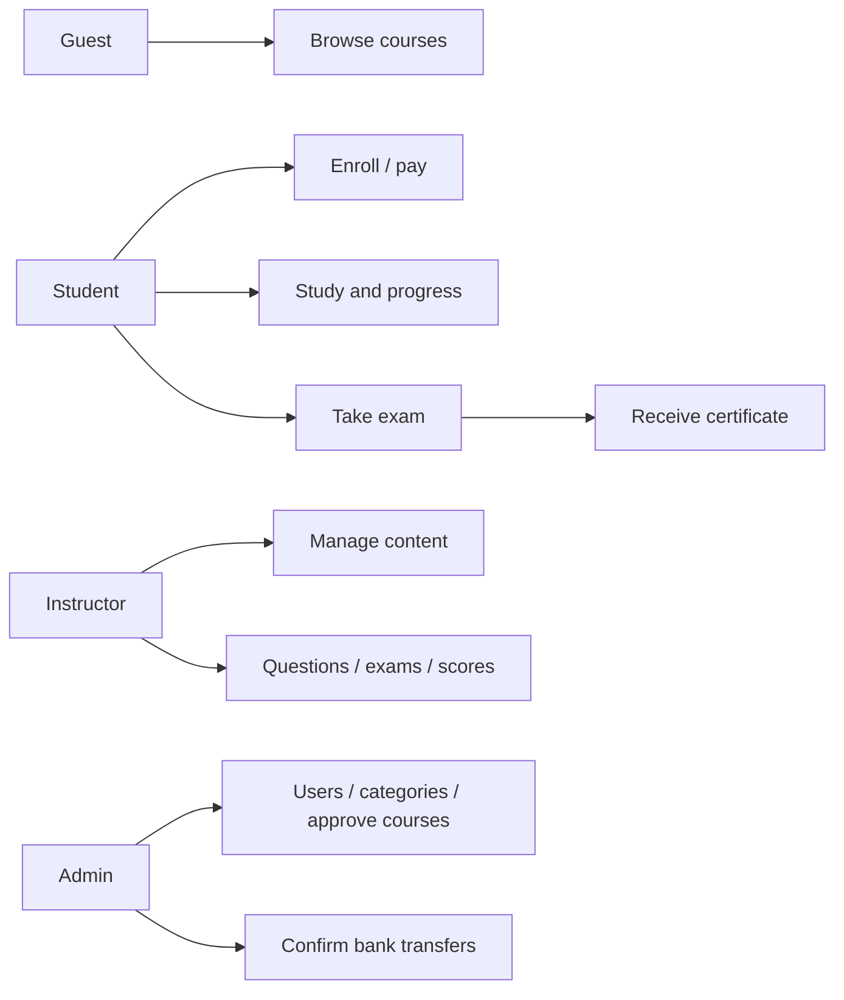

The non-functional requirements include three-layer authorization, Vietnamese validation messages, not trusting the client clock, N+1 prevention, a responsive interface, reproducible demo data, and automated tests. Sensitive data must not be rendered with unescaped Blade.

### 3.2 Complete Use Case List

| ID | Use case name | Actor | Description | Precondition | Postcondition |
|---|---|---|---|---|---|
| UC-G01 | View home page | Guest | View featured published courses | None | No data change |
| UC-G02 | Search/filter courses | Guest | Filter by keyword, category, level | None | Paginated list |
| UC-G03 | View course details | Guest | View description, sections, and preview lessons | Course is published | Information displayed |
| UC-G04 | View preview lesson | Guest | Open a lesson marked as preview | Lesson belongs to the course | Preview content displayed |
| UC-G05 | Register an account | Guest | Create a student account | Email does not yet exist | User with role student, logged in |
| UC-G06 | Log in | Any account | Authenticate with email/password | Account exists | Authenticated session |
| UC-G07 | Verify certificate | Guest | Look up a certificate code publicly | Has a code to look up | Shows valid/not found |
| UC-S01 | Enroll in a free course | Student | Activate the enrollment immediately | Logged in, course published/free | Pivot active |
| UC-S02 | Create an order for a paid course | Student | Create an enrollment and a pending order | Logged in, course published/paid | Order pending |
| UC-S03 | Pay by simulated card | Student | Submit a card number through the Mock gateway | Has a pending order | paid+active or remains pending |
| UC-S04 | Choose bank transfer | Student | Receive bank transfer instructions | Has a pending order | Awaiting admin confirmation |
| UC-S05 | View my courses | Student | List of enrollments and progress | Logged in | Paginated list |
| UC-S06 | Study a private lesson | Student | View video/document | Enrollment active | Content displayed |
| UC-S07 | Complete a lesson | Student | Send a Fetch JSON request | Enrollment active | lesson_user, new percentage |
| UC-S08 | View exam | Student | View configuration and attempt history | Enrollment active | No data change |
| UC-S09 | Start exam | Student | Create an attempt and empty answers | Exam published, attempts remaining, has questions | Attempt in_progress |
| UC-S10 | Save answer | Student | Select single/multiple | Attempt not yet expired | JSON option IDs saved |
| UC-S11 | Submit exam | Student | Automatic grading | Attempt in_progress | submitted, score, passed |
| UC-S12 | View exam history | Student | List of attempts | Logged in | Paginated list |
| UC-S13 | View result | Student | View score and answers | Owner of a submitted attempt | Result displayed |
| UC-S14 | View certificates | Student | List of issued certificates | Logged in | List of PDFs |
| UC-S15 | Download certificate | Student | Download PDF | Owner of the certificate, file exists | PDF response |
| UC-I01 | View dashboard | Instructor | Course and student statistics | Role instructor/admin | Dashboard displayed |
| UC-I02 | Create course | Instructor | Enter information and thumbnail | Logged in as instructor | Course draft/published |
| UC-I03 | Edit/delete course | Instructor | Manage own courses | Ownership | Data updated/deleted |
| UC-I04 | Manage sections | Instructor | CRUD sections and position | Owns the course | Section updated |
| UC-I05 | Manage lessons | Instructor | CRUD video/document/URL | Owns the course | Lesson updated |
| UC-I06 | View course students | Instructor | View enrollment/progress | Owns the course | List of students |
| UC-I07 | Create question | Instructor | Create single/multiple and options | Owns the course | New question/options |
| UC-I08 | Edit question | Instructor | Update content/options | Owns the question | Data changed |
| UC-I09 | Delete question | Instructor | Delete if not in any exam | Not used by an exam | Question deleted or warning |
| UC-I10 | Download Excel template | Instructor | Download `mau-cau-hoi.xlsx` | Logged in as instructor | XLSX response |
| UC-I11 | Import questions | Instructor | Read XLSX/CSV and validate rows | Owns the course | Valid questions created |
| UC-I12 | Export questions | Instructor | Export the question bank | Owns the course | XLSX response |
| UC-I13 | Create exam | Instructor | Select manually or randomly by difficulty | Owns the course | Exam and pivot questions |
| UC-I14 | Edit/delete exam | Instructor | Manage exam configuration | Owns the exam | Exam updated/deleted |
| UC-I15 | View exam results | Instructor | Statistics avg/max/min/pass rate | Owns the exam | Results table |
| UC-I16 | Export gradebook | Instructor | Download submitted attempts | Owns the exam | XLSX response |
| UC-A01 | View admin dashboard | Admin | System statistics | Role admin | Dashboard displayed |
| UC-A02 | Manage users | Admin | CRUD users, cannot delete self | Role admin | User updated |
| UC-A03 | Manage categories | Admin | CRUD categories | Role admin | Category updated |
| UC-A04 | Approve/hide course | Admin | Toggle draft/published | Role admin | Status changed |
| UC-A05 | View orders | Admin | Filter orders by status | Role admin | Paginated list |
| UC-A06 | Confirm bank transfer | Admin | Change pending to paid and active | Order pending | Enrollment active |

### 3.3 Flowchart-Style Use Case Diagram

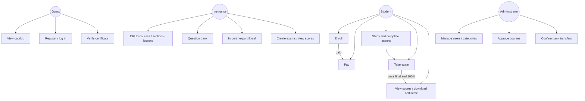

### 3.4 Specification of UC-S02/S03/S04 — Enrolling in a Paid Course

**Objective:** create a pending enrollment and activate it only after a valid payment.

**Precondition:** the user is logged in with role `student`; the course is `published`; `price > 0`.

**Main flow:** (1) the student POSTs `courses.enroll`; (2) the controller checks the course status; (3) `EnrollmentService` creates/updates the `course_user` pivot as `pending`; (4) a pending `orders` record is created; (5) redirect to checkout; (6) the student selects card and enters `4242...`; (7) the gateway returns success; (8) the order becomes `paid` and `paid_at` is set; (9) the service activates the pivot as `active`; (10) redirect to the learning page.

**Alternative flow A:** card number `4000...0002` is declined; the order and enrollment remain `pending`, an `error` flash is shown, and the student cannot yet open private lessons.

**Alternative flow B:** `bank_transfer` is chosen; the order remains `pending`; the admin PATCHes `admin.orders.confirm`; a transaction updates the order to `paid` and the enrollment to `active`.

**Postcondition:** there is no direct POST path that activates a paid course for free.

### 3.5 Specification of UC-S09–S11 — Taking an Exam

**Precondition:** the student has an active enrollment; the exam is published; the exam has at least one question; the current time is within the `starts_at`–`ends_at` window (an empty value means no limit on that side); the number of attempts used is less than `max_attempts` (`max_attempts = 0` means an unlimited number of attempts).

**Main flow:** (1) POST start; (2) handle any previous open attempt; (3) fetch question IDs and shuffle them if configured; (4) create the attempt with `started_at`, `expires_at = min(started_at + duration_minutes, ends_at)`, and `question_order`; (5) create empty answers; (6) Livewire mounts and authorizes; (7) the student selects options; (8) the server checks the deadline and the option; (9) submit; (10) the service locks the row, grades each question, and computes the percentage score, passed, and submitted_at; (11) try to issue a certificate.

**Exceptions:** an exam with 0 questions returns an error flash; when no attempts remain, no attempt is created; a save request after the deadline gets 409 and the attempt is graded; another user accessing the attempt gets 403; an exam that is not yet open or already closed does not allow a new attempt to start; an attempt in progress is graded automatically when the exam closing time is reached (even if the student has left the page, thanks to the `exams:finalize-expired` command that runs every minute and a sweep step when the instructor opens the results page/exports the gradebook).

**Alternative flow (monitoring):** for an exam with anti-cheat enabled, each time the user leaves the tab/window it is recorded and a warning is shown with the number of remaining occurrences; when `max_violations` is exceeded, the attempt is submitted automatically, flagged, and still graded normally. The instructor can see the count and the time of violations on the results page and in the gradebook file.

**Postcondition:** the attempt is no longer `in_progress`, the answers have `is_correct`, and the result can be reviewed.

### 3.6 Specification of UC-I11 — Importing Questions from Excel

**Precondition:** an instructor/admin is logged in; has permission to update the course; the file is `xlsx`, `xls`, or `csv`, at most 5 MB.

**Main flow:** (1) download the template; (2) fill in the columns `noi_dung`, `loai`, `do_kho`, answers A–F, `dap_an_dung`, `giai_thich`; (3) upload; (4) Form validation checks the file; (5) `QuestionsImport` reads the heading row; (6) validation checks enums and required fields; (7) parse the answer letters; (8) a transaction creates the questions/options; (9) return success.

**Exceptions:** a single-choice question with multiple correct answers, a multiple-choice question with no correct answer, or a letter outside A–F is written to `Failure`; the interface receives `import_errors` with row numbers.

**Postcondition:** only valid questions are created for the correct course, and `created_by` is the importing user.

### 3.7 Specification of UC-S14/S15 — Issuing and Downloading Certificates

**Precondition:** all lessons of the course are completed; if there is a final exam, a `passed=true` attempt exists.

**Main flow:** (1) completing a lesson or grading an exam calls `issueIfEligible`; (2) `ProgressService` computes 100%; (3) the service checks the final exam; (4) `firstOrCreate` the certificate for the user/course pair; (5) generate a unique code; (6) load user/course/instructor; (7) DomPDF renders A4 landscape; (8) store on the public disk; (9) return the certificate; (10) the owner downloads through a controller protected by a policy; a guest looks up the code at the verify route.

**Exceptions:** if progress is insufficient or the final exam is not passed, `null` is returned; a missing file is regenerated; another user downloading gets 403; a non-existent code still returns the lookup page with a message.

**Postcondition:** at most one certificate per user/course, enforced by a unique constraint.

### 3.8 Detailed Non-Functional Requirements

| ID | Requirement | How it is met |
|---|---|---|
| NFR-01 | Authentication security | Breeze, Hash, session, CSRF |
| NFR-02 | Authorization | auth → role/enrolled → Gate/Policy → Blade `@can` |
| NFR-03 | Data integrity | FK, unique, transaction, route binding |
| NFR-04 | List performance | eager loading, count subquery, pagination |
| NFR-05 | Usability | Vietnamese interface, flash success/error, responsive UI |
| NFR-06 | Exam timing reliability | `expires_at` checked on the server, auto grade |
| NFR-07 | Testability | SQLite memory, factory, Storage fake, E2E |
| NFR-08 | Maintainability | route modules, Form Request, Policy, Service |
| NFR-09 | Data compatibility | import/export XLSX/CSV, standard downloadable PDF |
| NFR-10 | Demo reproducibility | `migrate:fresh --seed`, fixed accounts |
| NFR-11 | Exam time window | `starts_at`/`ends_at`; an attempt's `expires_at` is capped by the exam closing time; the `exams:finalize-expired` command |
| NFR-12 | Anti-cheat monitoring | `exam_attempt_violations`, 3-second debounce, auto-submit and flag when the limit is exceeded |

## 4. Design

### 4.1 Architecture

The browser sends requests to the `student`, `instructor`, `admin`, and `exam` route groups; middleware performs authentication/authorization; a controller or Livewire component calls a service; Eloquent accesses MySQL; the result is returned as Blade, JSON, PDF, or XLSX.

### 4.2 ERD Generated from Migrations

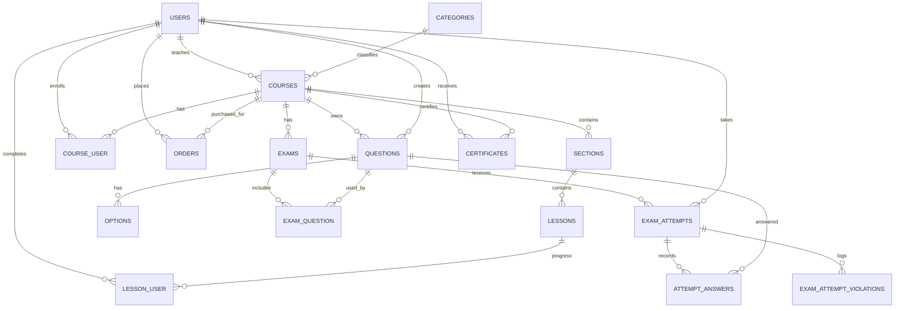

### 4.3 Table Descriptions

| Table | Purpose |
|---|---|
| `users` | accounts, roles, profiles |
| `categories`, `courses` | classification and course information |
| `sections`, `lessons` | content structure, video/documents, preview |
| `course_user`, `lesson_user` | N-N enrollment and progress |
| `orders` | amount, method, payment status |
| `questions`, `options` | question bank and correct/incorrect options |
| `exams`, `exam_question` | exam configuration and questions/points/order |
| `exam_attempts`, `attempt_answers` | time, score, status, and answers of each attempt |
| `exam_attempt_violations` | log of violations (leaving the tab/window) for each attempt |
| `certificates` | unique code, issue date, and PDF path |

### 4.3.1 Data Dictionary from Migrations

#### Table `users`

| Column | Type/attributes | Constraints and meaning |
|---|---|---|
| `id` | bigint unsigned | primary key |
| `name` | varchar | display full name |
| `email` | varchar | unique, login account |
| `email_verified_at` | timestamp nullable | time of email verification |
| `password` | varchar | hashed password |
| `role` | enum | `admin`, `instructor`, `student`; default student |
| `avatar` | varchar nullable | avatar image path |
| `bio` | text nullable | introduction |
| `remember_token` | varchar nullable | Breeze remember login |
| `created_at`, `updated_at` | timestamp | time trail |

#### Table `categories`

| Column | Type/attributes | Constraints and meaning |
|---|---|---|
| `id` | bigint unsigned | primary key |
| `name` | varchar | category name |
| `slug` | varchar | unique, used in URLs/data |
| `description` | text nullable | category description |
| timestamps | timestamp | creation/update dates |

#### Table `courses`

| Column | Type/attributes | Constraints and meaning |
|---|---|---|
| `id` | bigint unsigned | primary key |
| `instructor_id` | FK users | cascade delete, course owner |
| `category_id` | FK categories | cascade delete |
| `title` | varchar | course name |
| `slug` | varchar | unique, route key |
| `short_description` | text nullable | short description |
| `description` | longtext nullable | introductory content |
| `thumbnail` | varchar nullable | file on the public disk |
| `price` | decimal(12,0) | 0 means free |
| `level` | enum | beginner/intermediate/advanced |
| `status` | enum,index | draft/published |
| timestamps | timestamp | creation/update dates |

#### Tables `sections` and `lessons`

| Table.column | Type/attributes | Constraints and meaning |
|---|---|---|
| `sections.course_id` | FK courses | cascade delete |
| `sections.title` | varchar | section name |
| `sections.position` | unsigned int | order |
| `lessons.section_id` | FK sections | cascade delete |
| `lessons.title` | varchar | lesson name |
| `lessons.type` | enum | video/document |
| `video_path`, `video_url` | varchar nullable | video file or URL |
| `document_path` | varchar nullable | document file |
| `content` | longtext nullable | lesson content |
| `duration_minutes` | unsigned int | duration |
| `position` | unsigned int | order within the section |
| `is_preview` | boolean | guests are allowed to view |

#### Tables `course_user`, `lesson_user`, `orders`

| Table.column | Type/attributes | Constraints and meaning |
|---|---|---|
| `course_user.user_id` | FK users | cascade delete |
| `course_user.course_id` | FK courses | unique together with user_id |
| `course_user.status` | enum | pending/active |
| `price_paid` | decimal(12,0) | recorded amount |
| `enrolled_at` | timestamp nullable | activation time |
| `completed_at` | timestamp nullable | time 100% of lessons were reached |
| `lesson_user.user_id` | FK users | unique with lesson_id |
| `lesson_user.lesson_id` | FK lessons | completed lesson |
| `lesson_user.completed_at` | timestamp nullable | completion time |
| `orders.user_id` | FK users | purchaser |
| `orders.course_id` | FK courses | purchased course |
| `orders.code` | varchar unique | order code |
| `orders.amount` | decimal(12,0) | amount |
| `orders.method` | varchar | card/bank_transfer |
| `orders.status` | enum | pending/paid/failed |
| `orders.paid_at` | timestamp nullable | confirmation time |

#### Question and Exam Tables

| Table.column | Type/attributes | Constraints and meaning |
|---|---|---|
| `questions.course_id` | FK courses | cascade delete |
| `questions.created_by` | FK users | creator |
| `questions.content` | text | question content |
| `questions.type` | enum | single/multiple |
| `questions.difficulty` | enum | easy/medium/hard |
| `questions.explanation` | text nullable | explanation |
| `options.question_id` | FK questions | cascade delete |
| `options.content` | text | option |
| `options.is_correct` | boolean | correct answer |
| `exams.course_id` | FK courses | cascade delete |
| `exams.title` | varchar | exam name |
| `duration_minutes` | unsigned int | exam duration |
| `pass_score` | decimal(5,2) | percentage threshold |
| `max_attempts` | unsigned int | maximum number of attempts |
| `shuffle_questions` | boolean | shuffle order |
| `is_final` | boolean | final exam of the course |
| `status` | enum | draft/published |
| `starts_at`, `ends_at` | datetime nullable | exam opening/closing window; null means no limit |
| `anti_cheat_enabled` | boolean | enables anti-cheat monitoring, default false |
| `max_violations` | unsigned tinyint | number of page departures allowed, default 3 |
| `exam_question.exam_id` | FK exams | unique with question_id |
| `exam_question.question_id` | FK questions | question belonging to the exam |
| `exam_question.points` | decimal(5,2) | weight |
| `exam_question.position` | unsigned int | order |

#### Attempt and Certificate Tables

| Table.column | Type/attributes | Constraints and meaning |
|---|---|---|
| `exam_attempts.exam_id` | FK exams | exam being taken |
| `exam_attempts.user_id` | FK users | student |
| `started_at`, `expires_at` | timestamp | server-side time window |
| `submitted_at` | timestamp nullable | time of grading/submission |
| `score` | decimal(6,2) nullable | percentage score |
| `correct_count`, `total` | unsigned int | question count statistics |
| `passed` | boolean | threshold reached |
| `status` | enum | in_progress/submitted/expired |
| `question_order` | JSON nullable | added by a later migration, stable order |
| `violation_count` | unsigned smallint | number of recorded violations, default 0 |
| `flagged_at` | timestamp nullable | time of auto-submission for exceeding the violation limit |
| `exam_attempt_violations.exam_attempt_id` | FK exam_attempts | cascade delete |
| `exam_attempt_violations.type` | varchar(30) | `tab_hidden` or `window_blur` |
| `exam_attempt_violations.occurred_at` | timestamp | time of recording, indexed together with exam_attempt_id |
| `attempt_answers.exam_attempt_id` | FK attempts | unique with question_id |
| `attempt_answers.question_id` | FK questions | question being answered |
| `selected_option_ids` | JSON nullable | array of selected IDs |
| `is_correct` | boolean | grading result |
| `certificates.user_id` | FK users | unique together with course_id |
| `certificates.course_id` | FK courses | certified course |
| `certificates.code` | varchar unique | public lookup code |
| `certificates.issued_at` | timestamp | issue date |
| `certificates.file_path` | varchar nullable | PDF on the public disk |

### 4.4 Sequence Diagrams

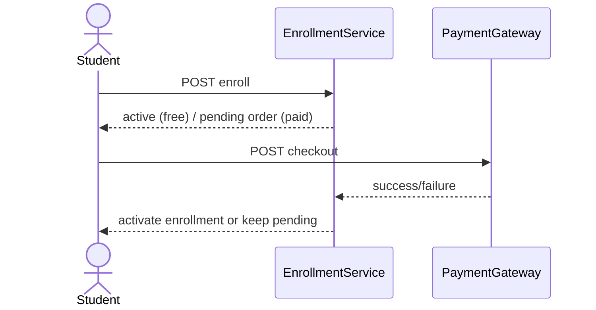

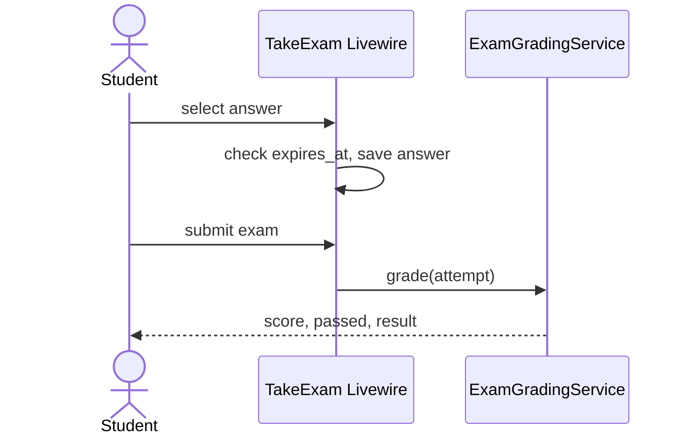

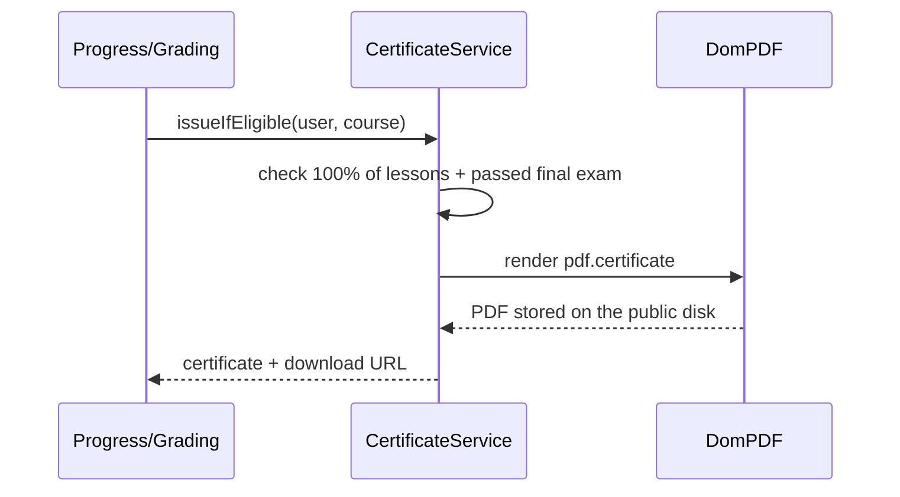

### 4.5 Authorization Matrix

| Function | Guest | Student | Owning instructor | Admin |
|---|:---:|:---:|:---:|:---:|
| Catalog/verify | ✓ | ✓ | ✓ | ✓ |
| Private lessons | log in | when active | preview of owned content | ✓ |
| Enroll/take exams/download certificate | – | own resources | – | per policy |
| CRUD content/exams/questions | – | – | ✓ | ✓ |
| Administration/confirm orders | – | – | – | ✓ |

Main routes: `/`, `/courses/{course}`, `/learn/{course}/{lesson?}`, `/checkout/{course}`, `/exams/{exam}`, `/attempts/{attempt}/take`, `/certificates/verify/{code}`, and the groups `/student/*`, `/instructor/*`, `/admin/*`. The exact list is obtained with `php artisan route:list --except-vendor`.

### 4.6 Main Business Route Table

| Method | URI | Route name | Protection |
|---|---|---|---|
| GET | `/` | `home` | public |
| GET | `/courses` | `courses.index` | public |
| GET | `/courses/{course:slug}` | `courses.show` | public |
| POST | `/courses/{course:slug}/enroll` | `courses.enroll` | auth, student |
| GET/POST | `/checkout/{course:slug}` | `checkout.show/pay` | auth, student |
| GET | `/learn/{course}/{lesson?}` | `learn.show` | auth, enrolled |
| POST | `/lessons/{lesson}/complete` | `lessons.complete` | auth, student, JSON |
| GET | `/exams/{exam}` | `exams.show` | auth, enrollment business rule |
| POST | `/exams/{exam}/start` | `exams.start` | auth, throttle |
| GET | `/attempts/{attempt}/take` | `attempts.take` | auth, can:update |
| GET | `/attempts/{attempt}/result` | `attempts.result` | auth, can:view |
| GET | `/student/attempts` | `student.attempts` | auth |
| GET | `/student/certificates` | `certificates.index` | auth |
| GET | `/certificates/{certificate}/download` | `certificates.download` | auth, can:view |
| GET | `/certificates/verify/{code}` | `certificates.verify` | public |
| GET | `/admin/dashboard` | `admin.dashboard` | auth, admin |
| PATCH | `/admin/orders/{order}/confirm` | `admin.orders.confirm` | auth, admin |
| resource | `/admin/users` | `admin.users.*` | auth, admin |
| resource | `/admin/categories` | `admin.categories.*` | auth, admin |
| resource | `/instructor/courses` | `instructor.courses.*` | instructor/admin, policy |
| resource | `/instructor/courses/{course}/questions` | `instructor.courses.questions.*` | role, can:update/view |
| POST | `/instructor/courses/{course}/questions/import` | `instructor.courses.questions.import` | can:update |
| GET | `/instructor/courses/{course}/questions/export` | `instructor.courses.questions.export` | can:update |
| resource | `/instructor/courses/{course}/exams` | `instructor.courses.exams.*` | role, policy |
| GET | `/instructor/exams/{exam}/results` | `instructor.exams.results` | can:view |
| GET | `/instructor/exams/{exam}/scores/export` | `instructor.exams.scores.export` | can:view |

## 5. Implementation

The actual structure is presented in `README.md`. The notable implementation points are:

- `CheckRole::handle()` splits the role list and rejects with 403; the `role` alias is registered in `bootstrap/app.php`, after `auth` on the route.
- Policies such as `CoursePolicy`, `QuestionPolicy`, and `ExamAttemptPolicy` check admin status, ownership, and the owner of an attempt; controllers still call `Gate::authorize`/`authorize`.
- `LessonRequest` validates files and uses the custom `YoutubeUrl`; `QuestionRequest` uses `AtLeastOneCorrectOption`; messages/attributes are in Vietnamese.
- `PaymentGatewayInterface::charge(Order $order, array $data): PaymentResult` allows the gateway to be replaced without changing the checkout controller.
- `TakeExam::selectOption()` confirms that the option belongs to the current question, checks permission/deadline, and then saves the JSON `selected_option_ids`.
- `ExamGradingService` locks the attempt within a transaction, compares the sets of correct options, computes the percentage safely when the total points equal 0, and triggers certificate issuing.
- `CertificateService` checks progress/final exam, generates a unique code, renders the PDF, and avoids duplicate issuing with the unique `(user_id, course_id)`.
- `QuestionsImport` validates each row; `ExamScoresExport` eager-loads attempts/users to export the gradebook.
- `LearnController::complete()` uses `ProgressService` and returns JSON containing `progress`, `course_completed`, and `certificate_url`; `learn.js` updates the interface.

## 6. Testing

| Group | Representative test cases | Expected result |
|---|---|---|
| Auth/role | register, log in, dashboard redirect | correct role |
| Learning | draft does not appear; free active; private blocked | correct HTTP/DB state |
| Payment | card 4242 succeeds; 4000…0002 stays pending; admin confirms | correct enrollment |
| Exam | max attempts (including 0 = unlimited), empty exam, timeout, correct answers | server enforces and grades correctly |
| Exam time window | not yet open, already closed, `expires_at` capped by closing time, auto-submit on closing | no attempts outside the window, in-progress attempts are graded |
| Anti-cheat | record violation, debounce, exceed limit, monitoring disabled, other user records | auto-submit + flag, graded normally |
| Certificate | enough progress + passed final; public verify | PDF exists, valid code |
| Excel | template/import/export | valid XLSX, round-trip data |
| Authorization | guest/student/other instructor/admin | correct redirect/403 |

The actual results are updated at the last acceptance run with `php artisan test`; tests are located in `tests/Feature`, including the integration group `tests/Feature/E2E`.

### 6.1 List of Actual Test Cases

| ID | Test name in source code | Description | Result |
|---|---|---|---|
| TC-01 | `registration_screen_can_be_rendered` | open the registration page | Pass |
| TC-02 | `new_users_can_register` | create a student account | Pass |
| TC-03 | `users_can_authenticate_using_the_login_screen` | log in with correct credentials | Pass |
| TC-04 | `users_can_not_authenticate_with_invalid_password` | reject a wrong password | Pass |
| TC-05 | `each_role_lands_on_its_dashboard_after_login` | redirect by role | Pass |
| TC-06 | `public_catalog_only_shows_published_courses` | hide drafts from the public | Pass |
| TC-07 | `free_course_is_activated_immediately` | free course is active immediately | Pass |
| TC-08 | `paid_course_card_payment_activates_enrollment` | successful card payment | Pass |
| TC-09 | `unenrolled_student_cannot_open_private_lesson` | private lesson returns 403 | Pass |
| TC-10 | `completed_lesson_returns_json_and_updates_progress` | progress JSON and pivot | Pass |
| TC-11 | `registered_student_completes_free_course_passes_final_exam_and_receives_certificate` | end-to-end full flow | Pass |
| TC-12 | `card_success_activates_enrollment_and_decline_keeps_it_pending` | both card success and decline | Pass |
| TC-13 | `bank_transfer_stays_pending_until_admin_confirms` | admin activates a bank transfer | Pass |
| TC-14 | `guest_is_redirected_from_every_protected_module` | guest matrix | Pass |
| TC-15 | `student_other_instructor_owner_instructor_and_admin_matrix` | five-role matrix | Pass |
| TC-16 | `exam_without_questions_cannot_start_and_used_question_cannot_be_deleted` | integrated guards | Pass |
| TC-17 | `student_can_start_answer_and_submit_single_and_multiple_questions` | grading single/multiple | Pass |
| TC-18 | `saving_after_expiry_is_rejected_and_attempt_is_finalized` | reject saving after the deadline | Pass |
| TC-19 | `max_attempts_is_enforced` | enforce the attempt limit | Pass |
| TC-20 | `another_student_cannot_access_attempt` | attempt policy | Pass |
| TC-21 | `certificate_is_issued_only_when_eligible_and_pdf_exists` | eligibility and PDF file | Pass |
| TC-22 | `verify_page_handles_valid_and_invalid_codes` | public verify | Pass |
| TC-23 | `template_is_xlsx_and_question_export_can_be_imported_without_losing_correct_options` | Excel round trip | Pass |
| TC-24 | `generated_xlsx_import_creates_questions_and_options` | XLSX import | Pass |
| TC-25 | `invalid_row_is_reported_in_vietnamese` | import error with row number | Pass |
| TC-26 | `owner_can_export_exam_scores` | export gradebook | Pass |
| TC-27 | `random_builder_selects_requested_difficulty_counts` | build a random exam | Pass |
| TC-28 | `manual_builder_keeps_order_and_points` | preserve order/weights | Pass |
| TC-29 | `admin_can_toggle_course_and_confirm_order` | approve course/confirm order | Pass |
| TC-30 | `instructor_cannot_edit_another_instructors_course` | course ownership | Pass |
| TC-31 | `admin_can_manage_categories_and_users` | admin manages categories and users | Pass |
| TC-32 | `non_admin_is_forbidden_and_admin_cannot_delete_self` | block non-admins, admin cannot delete self | Pass |
| TC-33 | `instructor_can_build_course_sections_and_lessons` | instructor builds course/sections/lessons | Pass |
| TC-34 | `lesson_upload_is_deleted_with_lesson` | delete uploaded files when a lesson is deleted | Pass |
| TC-35 | `another_instructor_cannot_access_question_bank` | question bank ownership | Pass |
| TC-36 | `owner_can_render_question_and_exam_pages` | course owner opens the question/exam pages | Pass |
| TC-37 | `draft_course_cannot_be_enrolled_and_paid_course_is_never_activated_for_free` | no enrollment in a draft course, a paid course is never activated for free | Pass |
| TC-38 | `guest_private_lesson_redirects_to_login_and_unenrolled_student_is_forbidden` | guest goes to login, unenrolled student gets 403 | Pass |
| TC-39 | `completed_course_with_certificate_shows_view_certificate_button_opening_pdf_inline` | the "Xem chứng chỉ" (View certificate) button opens the PDF inline | Pass |
| TC-40 | `finished_lessons_without_passed_final_exam_prompts_final_exam` | lessons finished but final exam not passed prompts the exam | Pass |
| TC-41 | `progress_service_returns_first_uncompleted_lesson` | determine the next lesson | Pass |
| TC-42 | `it_builds_84_days_and_combines_activity_sources` | 12-week heatmap combining lessons and exam attempts | Pass |
| TC-43 | `student_cannot_start_before_window_opens` | cannot start when the exam is not yet open | Pass |
| TC-44 | `student_cannot_start_after_window_closes` | cannot start when the exam is already closed | Pass |
| TC-45 | `start_inside_window_caps_deadline_at_closing_time` | `expires_at` is capped by the exam closing time | Pass |
| TC-46 | `in_progress_attempt_is_auto_submitted_when_exam_closes` | saving an answer after closing returns 409 and the attempt is graded | Pass |
| TC-47 | `opening_take_page_after_close_grades_and_redirects_to_result` | opening the exam page after closing grades the attempt and redirects to the result | Pass |
| TC-48 | `show_page_displays_window_state` | the exam page shows "Chưa mở" (Not yet open) / "Đang mở" (Open) / "Đã đóng" (Closed) | Pass |
| TC-49 | `closing_time_must_be_after_opening_time` | validate that the closing time is after the opening time | Pass |
| TC-50 | `instructor_can_save_window_and_anti_cheat_settings` | instructor saves the time window and monitoring settings | Pass |
| TC-51 | `shortening_closing_time_clamps_in_progress_attempts` | shortening the closing time updates in-progress attempts, without reviving expired attempts | Pass |
| TC-52 | `results_page_finalizes_abandoned_expired_attempts` | the results page grades abandoned attempts | Pass |
| TC-53 | `zero_max_attempts_means_unlimited` | `max_attempts = 0` means an unlimited number of attempts | Pass |
| TC-54 | `limited_max_attempts_still_blocks` | the attempt limit is still enforced | Pass |
| TC-55 | `violation_is_recorded_and_state_returned` | record a violation and return the remaining count | Pass |
| TC-56 | `burst_of_events_counts_once_and_again_after_debounce` | 3-second debounce | Pass |
| TC-57 | `exceeding_limit_auto_submits_flags_and_redirects` | exceeding the limit auto-submits, flags, and grades normally | Pass |
| TC-58 | `zero_tolerance_submits_on_first_violation` | `max_violations = 0` | Pass |
| TC-59 | `violations_are_ignored_when_anti_cheat_disabled` | exam with monitoring disabled records nothing | Pass |
| TC-60 | `submitted_attempts_and_unknown_types_are_ignored` | ignore submitted attempts and unknown event types | Pass |
| TC-61 | `other_user_cannot_record_violations` | another user cannot record violations on your attempt | Pass |
| TC-62 | `results_page_and_export_show_violations` | the results page and gradebook show violations | Pass |
| TC-63 | `take_page_shows_proctoring_banner_only_when_enabled` | the monitoring banner appears only when enabled | Pass |
| TC-64 | `ends_at_without_starts_at_passes_validation` | setting only the closing time (no opening time) is still valid | Pass |
| TC-65 | `finalize_expired_grades_all_expired_attempts_at_their_deadline` | the sweep grades every expired attempt, `submitted_at` = deadline | Pass |
| TC-66 | `finalize_expired_continues_after_one_attempt_fails` | one attempt failing during grading does not stop the whole sweep | Pass |
| TC-67 | `extending_closing_time_extends_in_progress_attempt` | extending the closing time updates `expires_at` of in-progress attempts | Pass |
| TC-68 | `violation_after_deadline_grades_attempt_and_records_nothing` | reporting a violation after the deadline grades the attempt and records no violation | Pass |
| TC-69 | `user_index_has_create_modal_that_reopens_with_errors` | the add-user modal reopens with errors and old input | Pass |
| TC-70 | `password_inputs_render_visibility_toggle` | password fields render a show/hide toggle | Pass |
| TC-71 | `data_science_category_uses_data_photo_not_database_photo` | a "Khoa học dữ liệu" course gets the data photo, not the database photo | Pass |

Besides the 71 cases above, the remaining 21 tests are the default Laravel Breeze test suite (registration, login, forgot/reset password, email verification, personal profile) and 2 Laravel example tests; all of them pass.

### 6.2 Acceptance Run Results

Command executed:

```bash
php artisan test
```

Actual result at the last acceptance run (21 November 2026):

```text
Tests: 92 passed (405 assertions)
Duration: 2.45s
```

The timing cases are verified precisely by `OnlineExamTest::test_saving_after_expiry_is_rejected_and_attempt_is_finalized` and `OnlineExamTest::test_max_attempts_is_enforced`; therefore no renamed duplicate `ExamTimingTest` is created. Opening an expired attempt is also covered by the first case: the Livewire mount calls finalize and redirects to the result.

## 7. User Interface Results

The images below were captured automatically with headless Chrome from the running application with seed data (logged in with the demo accounts); additional images are in `docs/images/extra/`.

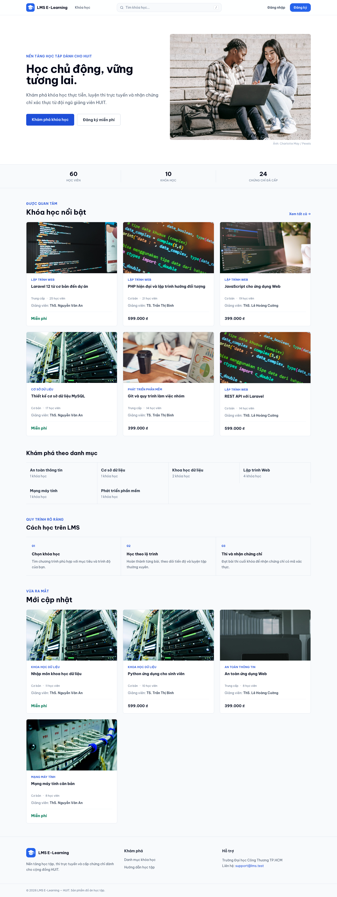

*Public page: featured courses, search/filter, and free/paid status.*

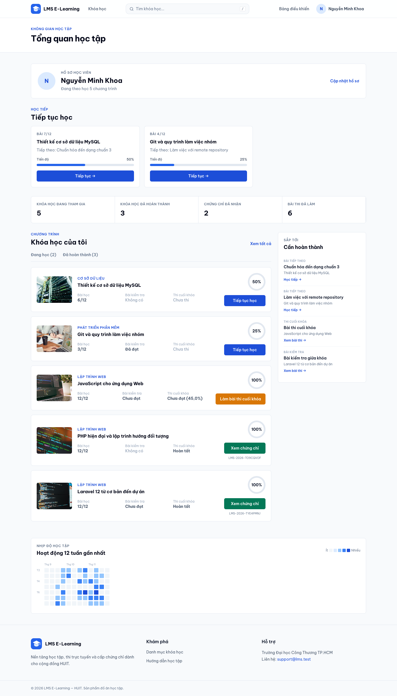

*Student profile, the "Tiếp tục học" (Continue learning) strip with the next lesson, the "Đang học" (In progress) / "Đã hoàn thành" (Completed) tabs, lesson/quiz/final exam status, the "Xem chứng chỉ" (View certificate) button, and the 12-week activity heatmap.*

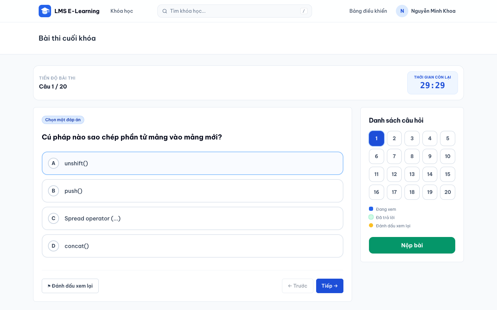

*Timer, question navigation, answered status, the submit button, and the "Giám sát thi" (Exam proctoring) strip showing the number of recorded page departures.*

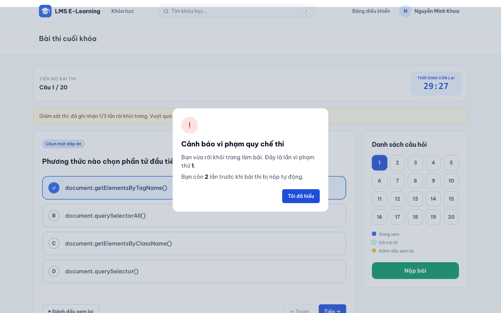

*When the student leaves the exam window/tab, the server records a violation and the page shows a warning with the number of remaining occurrences before the exam is submitted automatically.*

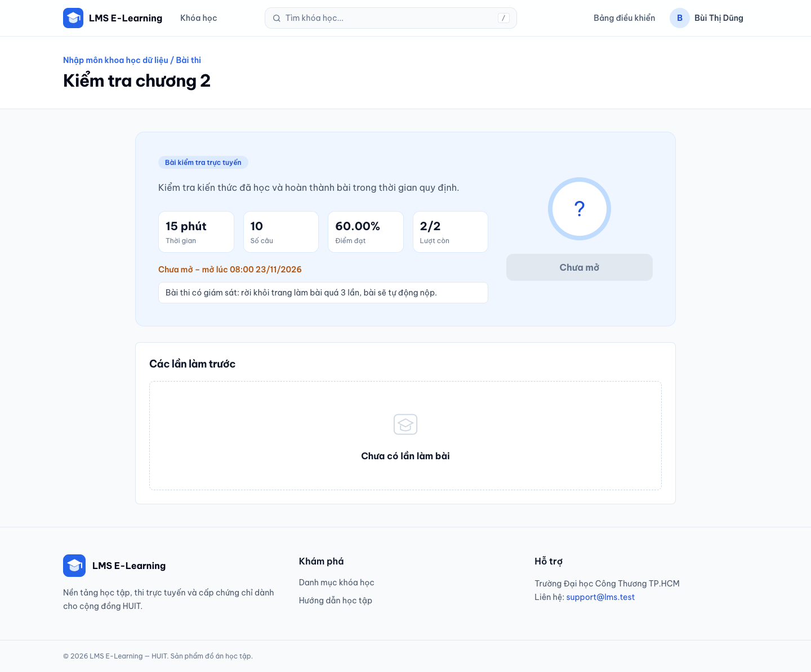

*Exam introduction page outside the time window: status "Chưa mở – mở lúc …" (Not yet open – opens at …), the take-exam button locked, and the monitoring rules.*

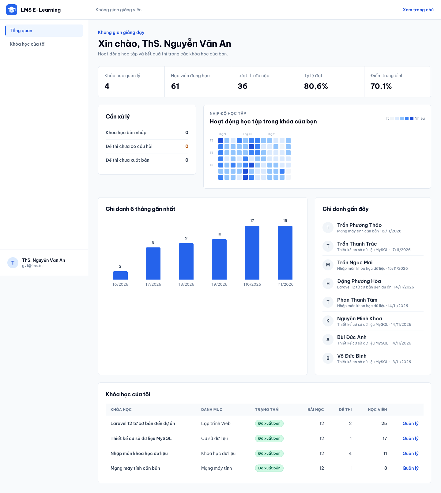

*Attempt count, pass rate, average score, a 6-month enrollment chart, recent enrollments, and the course table.*

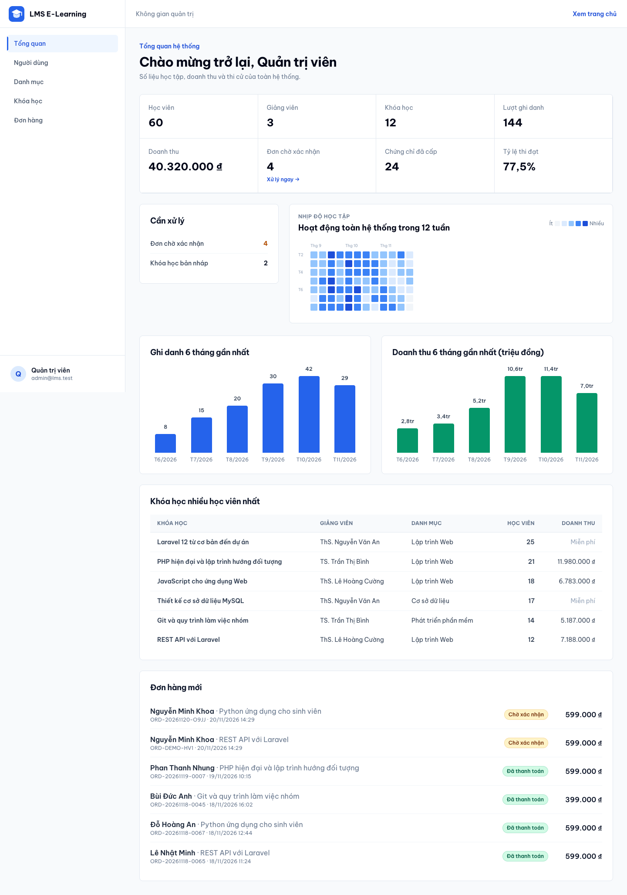

*8 overview metrics, the "Cần xử lý" (Needs attention) panel, the activity heatmap, 6-month enrollment and revenue charts, the courses with the most students, and the latest orders.*

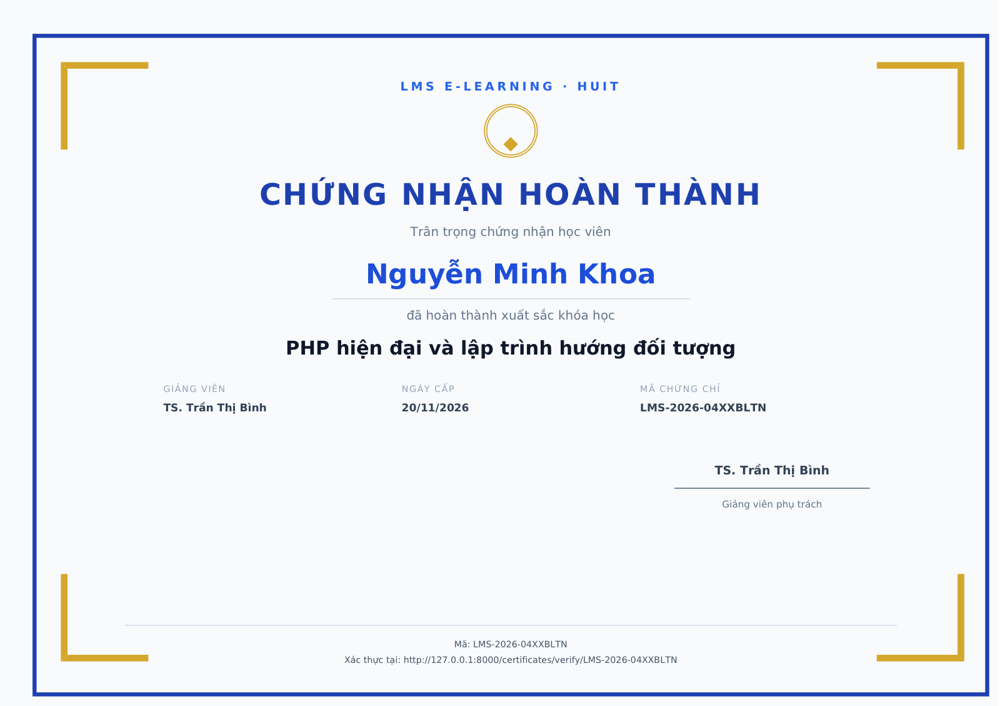

*Student name, course, instructor, certificate code, and issue date.*


*Instructor information, sections/lessons, price, and the enrollment call to action.*

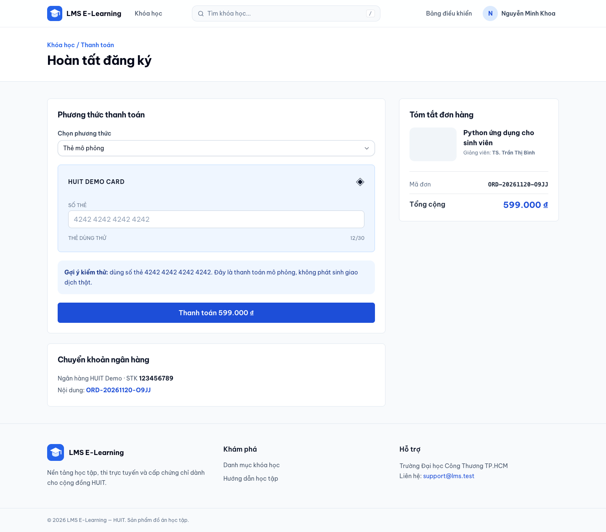

*Choosing a simulated card or bank transfer, and displaying the order status.*

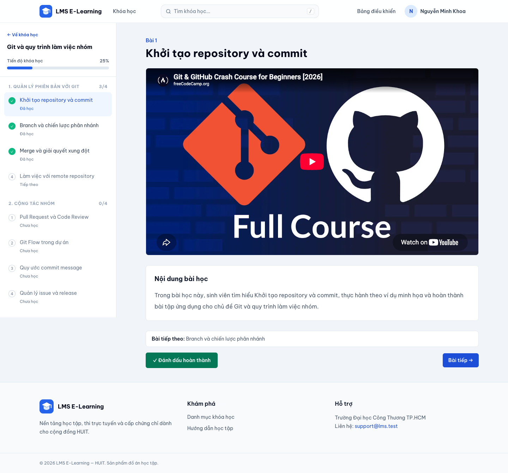

*Section/lesson sidebar, video/document content, and the progress bar.*

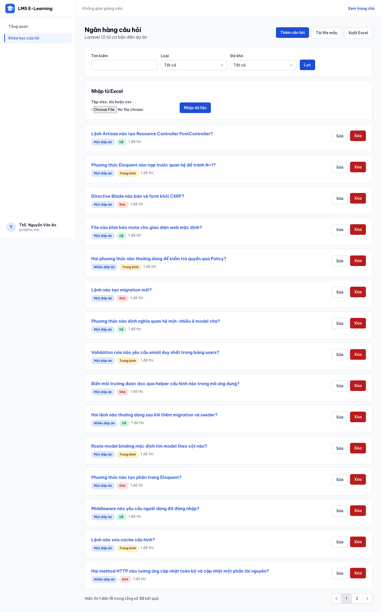

*Filters, the number of exams using each question, and Excel operations.*

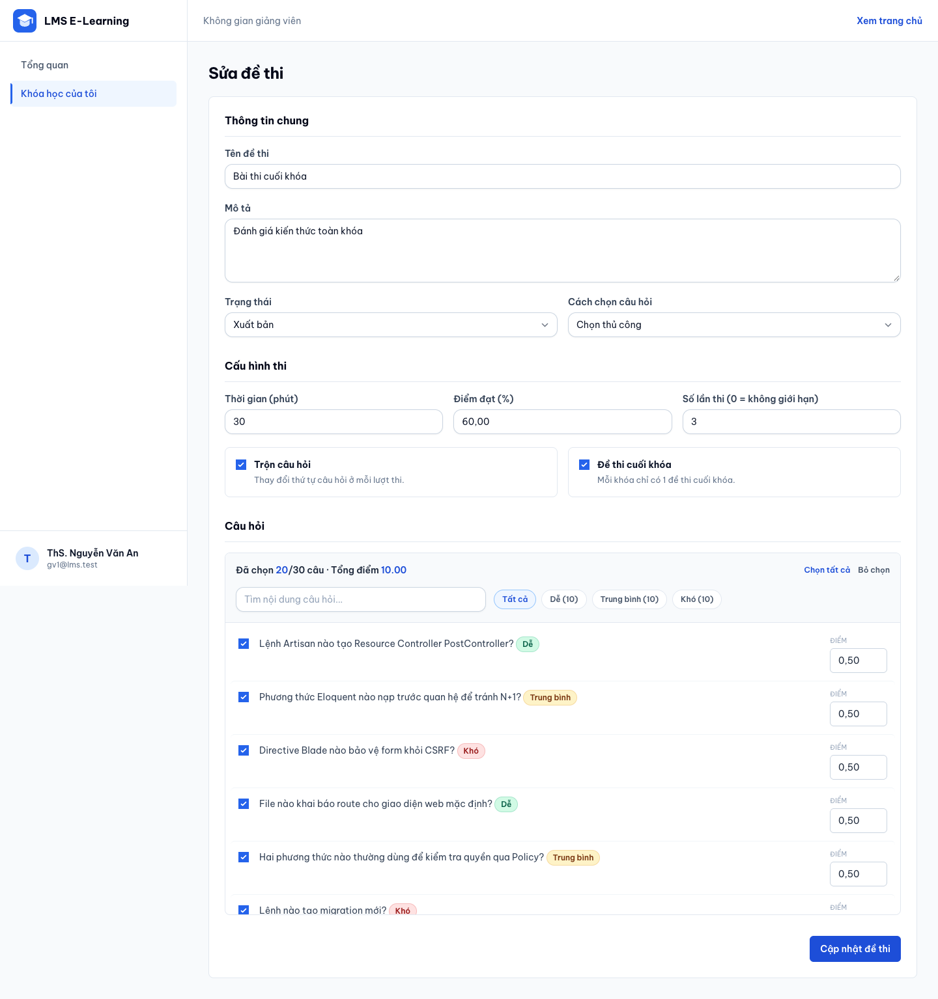

*Setting the opening/closing schedule, anti-cheat monitoring, duration, pass score, number of attempts, and question selection.*

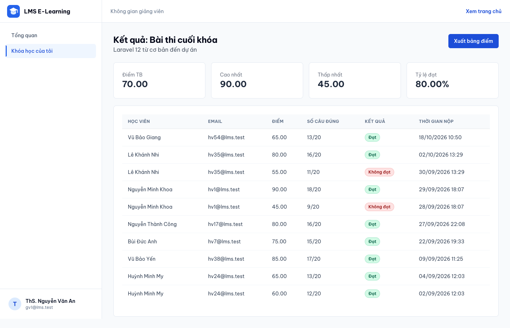

*Average/highest/lowest score, pass rate, number of flagged attempts, the violations column (click to see the times), and the export button.*

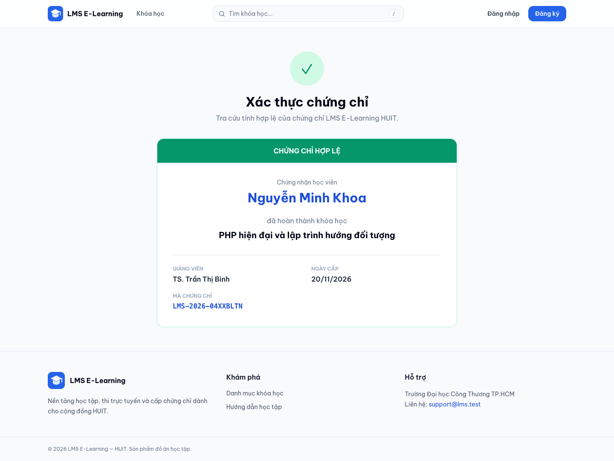

*Result for a valid code or a not-found message.*

## 8. Conclusion and Future Work

### 8.1 Achievements

The project delivers a multi-role LMS with 99 application routes. The student flow goes from registration, enrollment, payment, and study through exams to the certificate; instructors manage content/questions/exams/scores; the admin manages data and confirms bank transfers. The architecture follows MVC, Eloquent, migrations, Form Requests, middleware, policies, and services. Exams support an opening/closing time window and browser-level anti-cheat monitoring. The admin adds users from a modal on the user list, and every password field has a show/hide toggle. The test suite consists of 92 tests/405 assertions, all passing.

### 8.2 Limitations

- Payment is only simulated, and bank webhooks are not yet verified.
- Video uses files/URLs, with no adaptive streaming transcoding.
- Anti-cheat operates only at the browser level (detecting when the user leaves the tab/window, and blocking copy and paste); it cannot prevent a second device, screen capture, or face recognition; it does not require full-screen mode.
- There is no email/notification queue for order confirmation and certificate issuing.
- The dashboards focus only on basic business statistics and have no deep learning analytics yet.

### 8.3 Future Work

- Integrate VNPay/MoMo with signatures and idempotent webhooks.
- Store video/objects on S3-compatible storage and serve them via HLS.
- Add queues, email, and in-app notifications.
- Add rubrics, essay assignments, and manual grading.
- Add a blueprint-based exam bank and random selection with an auditable seed.
- Add device limits, full-screen mode, and webcam monitoring.
- Build an API token for mobile applications.
- Add cohort, study time, and question analysis reports.

## 9. References

1. Laravel, *Laravel 12.x Documentation*, https://laravel.com/docs/12.x (accessed November 2026).
2. Livewire, *Livewire 3 Documentation*, https://livewire.laravel.com/docs/3.x (accessed November 2026).
3. barryvdh, *Laravel DomPDF*, https://github.com/barryvdh/laravel-dompdf (accessed November 2026).
4. SpartnerNL, *Laravel Excel Documentation*, https://docs.laravel-excel.com (accessed November 2026).
5. Laravel, *Laravel Breeze*, https://laravel.com/docs/12.x/starter-kits (accessed November 2026).
6. PHP Group, *PHP Manual — Classes and Objects*, https://www.php.net/manual/en/language.oop5.php.
7. Course slides for Open Source Programming (Lập trình mã nguồn mở), HUIT: Chapter 2 PHP OOP; Lesson 6 Laravel/MVC; Lesson 7 Routing/Blade; Lesson 8 Eloquent/Migration/Seeder; Lesson 9 Validation/Middleware/Auth/Policy; the JavaScript part and PHP interaction.
